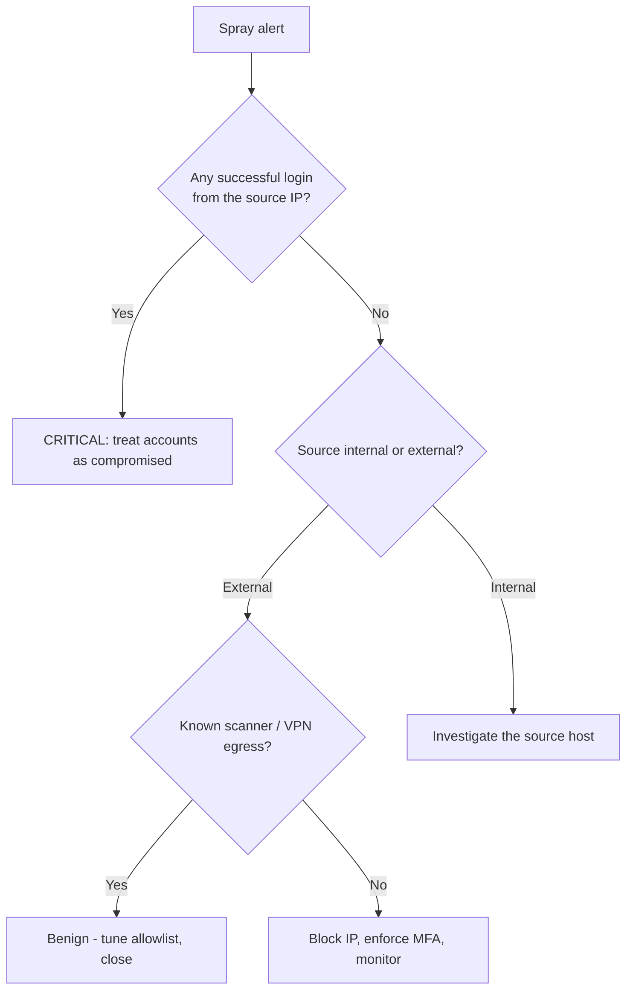

<div align="center">

# 🧭 SOC Triage Playbooks

### Decision-tree playbooks that turn a SIEM alert into a confident verdict in minutes

**23 playbooks · Mermaid decision trees · copy-paste UDM queries · linked to 298 detection rules**

[](https://github.com/rizwancyberlock-svg/soc-triage-playbooks/actions/workflows/validate.yml)


[Playbook index](playbooks/INDEX.md) · [Triage method](framework/triage-method.md) · [Severity matrix](framework/severity-matrix.md) · [Contribute](CONTRIBUTING.md)

</div>

---

## The problem

SOC analysts drown in alerts, and most alerts arrive with no instructions. Junior analysts escalate everything, senior analysts carry the know-how in their heads, and every shift investigates the same alert differently.

Each playbook here answers, for one alert family:

1. **What is the one question that matters?** ("Did any account succeed?")
2. **How do I decide?** A visual decision tree, rendered natively by GitHub.
3. **Where do I look?** Copy-paste Google SecOps UDM search queries.
4. **How do I tell real from noise?** True-positive vs false-positive indicators.
5. **What do I do now?** Containment steps, escalation criteria and evidence to collect.

Every playbook links to the matching rules in **[open-yaral-detections](https://github.com/rizwancyberlock-svg/open-yaral-detections)**, and the link is verified by CI.

## Playbooks

| Area | Playbooks |
|---|---|
| 🔑 **Identity** | [Password spray](playbooks/identity/password-spray.md) · [Brute force → success](playbooks/identity/brute-force-success.md) · [MFA fatigue](playbooks/identity/mfa-fatigue.md) · [Impossible travel / AiTM](playbooks/identity/impossible-travel.md) · [Privileged role assignment](playbooks/identity/privileged-role-assignment.md) · [Illicit OAuth consent](playbooks/identity/oauth-illicit-consent.md) |
| 💻 **Endpoint** | [Suspicious PowerShell](playbooks/endpoint/suspicious-powershell.md) · [Credential dumping](playbooks/endpoint/credential-dumping.md) · [Ransomware](playbooks/endpoint/ransomware-precursor.md) · [Malicious Office document](playbooks/endpoint/malicious-office-document.md) · [Web shell](playbooks/endpoint/webshell.md) · [EDR high-severity alert](playbooks/endpoint/edr-high-severity-alert.md) · [Linux reverse shell](playbooks/endpoint/linux-reverse-shell.md) |
| ☁️ **Cloud** | [Logging tampering](playbooks/cloud/cloud-logging-tampering.md) · [New long-lived credentials](playbooks/cloud/cloud-credential-creation.md) · [Storage exposure](playbooks/cloud/storage-public-exposure.md) |
| 🌐 **Network** | [DNS tunneling / DGA / C2](playbooks/network/dns-tunneling-c2.md) · [Data exfiltration](playbooks/network/data-exfiltration-volume.md) · [Web application attack](playbooks/network/web-application-attack.md) |
| 🗄️ **Data security** | [Database abuse (Guardium)](playbooks/data/dam-database-abuse.md) · [DLP / insider exfiltration](playbooks/data/dlp-exfiltration.md) · [PAM vault abuse (CyberArk / ARCON)](playbooks/data/pam-vault-abuse.md) · [HSM key custody (Thales)](playbooks/data/hsm-key-custody.md) |

Full table with ATT&CK mappings and linked rules: **[playbooks/INDEX.md](playbooks/INDEX.md)**

## Example: the password-spray decision tree



## SOC framework

- **[Universal triage method](framework/triage-method.md)**: five steps that work for any alert, plus a closure-note template
- **[Severity & priority matrix](framework/severity-matrix.md)**: rule severity × asset tier → P1–P4, with response-time targets
- **[Escalation & shift handover](framework/escalation-and-handover.md)**: who to call, plus a handover template

## Using with other SIEMs

The queries use Google SecOps UDM syntax, but the decision logic works in any SIEM. You can translate the queries with **[rosetta-siem](https://github.com/rizwancyberlock-svg/rosetta-siem)** (YARA-L ↔ KQL ↔ SPL ↔ AQL).

## Validate locally

```bash
python tools/check_playbooks.py playbooks --index playbooks/INDEX.md \
  --rules-dir ../open-yaral-detections/rules
```

## Part of a defender toolkit

| Repo | Role |
|---|---|
| [open-yaral-detections](https://github.com/rizwancyberlock-svg/open-yaral-detections) | Detect in Google SecOps: 298 YARA-L rules |
| [sentinel-kql-detections](https://github.com/rizwancyberlock-svg/sentinel-kql-detections) | Detect in Microsoft Sentinel: 191 KQL rules |
| **soc-triage-playbooks** (you are here) | Investigate & respond |
| [rosetta-siem](https://github.com/rizwancyberlock-svg/rosetta-siem) | Translate between SIEM query languages |

## Author

Built and maintained by **Rizwan Ahmed**, a Security Engineer focused on SIEM/SOAR, DAM and HSM.

⭐ Star the repo if it helps your SOC, and open a PR with your own playbooks.
