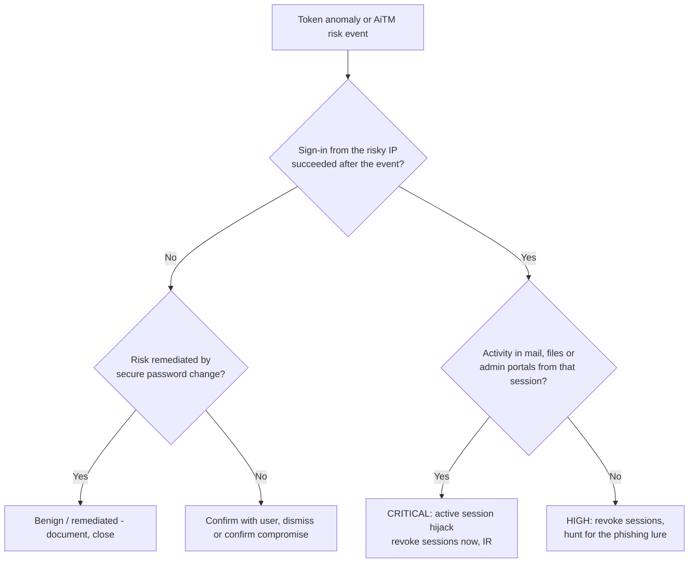

<div align="center">

# 🧭 SOC Triage Playbooks

### Decision-tree playbooks that turn a SIEM alert into a confident verdict in minutes, plus a printable SOC IR Field Guide

**60 playbooks · Google SecOps + Microsoft Sentinel · 99 ATT&CK techniques · every KQL query compiled against the real Sentinel schemas**

[](https://github.com/rizwancyberlock-svg/soc-triage-playbooks/actions/workflows/validate.yml)


[📘 Download the SOC IR Field Guide (PDF)](https://github.com/rizwancyberlock-svg/soc-triage-playbooks/releases/latest) · [Playbook index](playbooks/INDEX.md) · [Triage method](framework/triage-method.md) · [IR lifecycle](framework/incident-response-lifecycle.md) · [Contribute](CONTRIBUTING.md)

</div>

---

## The problem

SOC analysts drown in alerts, and most alerts arrive with no instructions. Junior analysts escalate everything, senior analysts carry the know-how in their heads, and every shift investigates the same alert differently.

Each playbook here answers, for one alert family:

1. **What fires it?** The exact detections in Google SecOps (YARA-L) and Microsoft Sentinel (KQL) that lead here.
2. **How do I decide?** A visual decision tree, rendered natively by GitHub.
3. **Where do I look?** Copy-paste **Sentinel KQL** and **SecOps UDM** queries.
4. **How do I tell an attack from noise?** True-positive vs false-positive indicators.
5. **What do I do now?** Containment, hardening, escalation criteria and the evidence to preserve.

## 📘 SOC IR Field Guide

All 60 playbooks and the SOC framework in one printable, linked PDF: a cover, a clickable contents page, a page per playbook with its rendered decision tree, and an ATT&CK technique index.

➡️ **[Download it from the latest release](https://github.com/rizwancyberlock-svg/soc-triage-playbooks/releases/latest)**, or build it yourself:

```bash
python tools/build_field_guide.py --out field-guide/SOC-IR-Field-Guide.html --pdf field-guide/SOC-IR-Field-Guide.pdf
```

## Playbooks

| Area | Playbooks |
|---|---|
| 🔑 **Identity** (13) | [Password Spray](playbooks/identity/password-spray.md) · [Brute Force Followed by Successful Login](playbooks/identity/brute-force-success.md) · [MFA Fatigue / Push Bombing](playbooks/identity/mfa-fatigue.md) · [Impossible Travel / Multi-Country Logins](playbooks/identity/impossible-travel.md) · [Privileged Role or Group Assignment](playbooks/identity/privileged-role-assignment.md) · [Illicit OAuth Consent / App Credential Backdoor](playbooks/identity/oauth-illicit-consent.md) · [Token Theft / Session Replay](playbooks/identity/token-theft-session-replay.md) · [Federation / Domain Trust Tampering](playbooks/identity/federation-trust-tampering.md) · [App / Service Principal Credential Backdoor](playbooks/identity/app-credential-backdoor.md) · [Application Permission (App-Only) Granted](playbooks/identity/app-only-permission-grant.md) · [Conditional Access Policy Weakened](playbooks/identity/conditional-access-weakened.md) · [Kerberoasting](playbooks/identity/kerberoasting.md) · [DCSync / NTDS.dit Theft (Domain Compromise)](playbooks/identity/domain-replication-dcsync.md) |
| 📧 **Email** (6) | [Phishing Delivered to Inbox / URL Clicked](playbooks/email/phish-delivered-or-clicked.md) · [Malware or Risky Attachment Delivered](playbooks/email/malware-attachment-delivered.md) · [BEC - Malicious Inbox Rules and Forwarding](playbooks/email/bec-inbox-rules-forwarding.md) · [Compromised Mailbox Sending Phish / Mass Outbound](playbooks/email/compromised-mailbox-outbound.md) · [Mailbox Accessed by Non-Owner / Bulk Mail Read](playbooks/email/mailbox-access-non-owner.md) · [Executive / Brand Impersonation (Email and Teams)](playbooks/email/executive-impersonation.md) |
| 🗂️ **SaaS & M365 data** (4) | [Mass Download from SharePoint / OneDrive / SaaS](playbooks/saas/mass-download-saas.md) · [External Sharing / Anonymous Links](playbooks/saas/external-sharing-anonymous-links.md) · [Data Upload to GenAI or Unsanctioned Cloud Apps](playbooks/saas/genai-unsanctioned-app-upload.md) · [eDiscovery / Content Search Abuse](playbooks/saas/ediscovery-content-search-abuse.md) |
| 💻 **Endpoint** (14) | [Suspicious PowerShell Execution](playbooks/endpoint/suspicious-powershell.md) · [Credential Dumping (LSASS, SAM, NTDS, DCSync)](playbooks/endpoint/credential-dumping.md) · [Ransomware Precursors and Encryption](playbooks/endpoint/ransomware-precursor.md) · [Malicious Office Document / Phishing Execution](playbooks/endpoint/malicious-office-document.md) · [Web Shell / Exploited Web Application](playbooks/endpoint/webshell.md) · [EDR High-Severity Alert (CrowdStrike / SentinelOne / Defender)](playbooks/endpoint/edr-high-severity-alert.md) · [Linux Reverse Shell and Persistence](playbooks/endpoint/linux-reverse-shell.md) · [Security Tool Tampering (EDR / AV Disabled)](playbooks/endpoint/security-tool-tampering.md) · [Vulnerable Driver Loaded (BYOVD)](playbooks/endpoint/vulnerable-driver-byovd.md) · [Persistence via Scheduled Task, Service or Run Key](playbooks/endpoint/persistence-task-service-runkey.md) · [Lateral Movement via PsExec / WMI / Remote Services](playbooks/endpoint/lateral-movement-remote-exec.md) · [Remote Access Tool or Tunnel Installed](playbooks/endpoint/remote-access-tunneling.md) · [Log Clearing and Anti-Forensics](playbooks/endpoint/log-clearing-anti-forensics.md) · [Active Directory Reconnaissance (BloodHound / LDAP)](playbooks/endpoint/ad-reconnaissance.md) |
| ☁️ **Cloud** (11) | [Cloud Audit Logging Tampering](playbooks/cloud/cloud-logging-tampering.md) · [New Long-Lived Cloud Credentials](playbooks/cloud/cloud-credential-creation.md) · [Cloud Storage Exposure and Snapshot Sharing](playbooks/cloud/storage-public-exposure.md) · [Cloud Privilege Escalation (Role / Policy Grant)](playbooks/cloud/cloud-privilege-escalation.md) · [Root / Break-Glass Account Usage](playbooks/cloud/root-break-glass-usage.md) · [Cloud Snapshot, Disk or Database Export](playbooks/cloud/snapshot-or-database-export.md) · [Cloud Key and Secret Harvesting](playbooks/cloud/cloud-key-secret-harvesting.md) · [Cryptojacking / Compute Abuse](playbooks/cloud/cryptojacking-compute-abuse.md) · [CI/CD Pipeline and Secret Tampering](playbooks/cloud/cicd-pipeline-secret-tampering.md) · [Cloud Destructive Activity (Mass Deletion / Key Deletion)](playbooks/cloud/cloud-destructive-activity.md) · [Remote Command on Cloud VM (Run Command / SSM)](playbooks/cloud/cloud-vm-remote-command.md) |
| 🌐 **Network & edge** (7) | [DNS Tunneling, DGA and C2 Domains](playbooks/network/dns-tunneling-c2.md) · [Large Outbound Transfer / Exfiltration Tools](playbooks/network/data-exfiltration-volume.md) · [Web Application Attack (WAF)](playbooks/network/web-application-attack.md) · [VPN Brute Force / Credential Stuffing](playbooks/network/vpn-credential-attack.md) · [Edge Device Exploitation (VPN, Firewall, Load Balancer)](playbooks/network/edge-device-exploitation.md) · [Internal Port Scan / Host Sweep](playbooks/network/internal-scanning.md) · [C2 Beaconing / Threat-Intel Match](playbooks/network/beaconing-c2.md) |
| 🗄️ **Data security** (5) | [Database Abuse (Guardium DAM)](playbooks/data/dam-database-abuse.md) · [DLP Incident / Insider Exfiltration](playbooks/data/dlp-exfiltration.md) · [PAM Vault Abuse (CyberArk / ARCON)](playbooks/data/pam-vault-abuse.md) · [HSM / Key Management Attack (Thales Luna, CipherTrust)](playbooks/data/hsm-key-custody.md) · [USB / Removable Media Exfiltration](playbooks/data/usb-removable-media-exfiltration.md) |

Full table with ATT&CK mappings and linked rules for both SIEMs: **[playbooks/INDEX.md](playbooks/INDEX.md)**

## Example: the token-theft decision tree



## SOC framework

- **[Universal triage method](framework/triage-method.md)**: five steps that work for any alert, plus a closure-note template
- **[Severity & priority matrix](framework/severity-matrix.md)**: rule severity × asset tier → P1–P4, with response-time targets
- **[Escalation & shift handover](framework/escalation-and-handover.md)**: who to call, plus a handover template
- **[Incident response lifecycle](framework/incident-response-lifecycle.md)**: the first 15 minutes, containment by asset type, eradication, recovery and lessons learned (NIST SP 800-61 Rev. 3 / CSF 2.0)

## Quality gates

Every push runs in CI:

| Check | What it guarantees |
|---|---|
| `tools/check_playbooks.py` | Front matter, all required sections, Mermaid decision trees, unique IDs, and no broken links between playbooks |
| Cross-check against **open-yaral-detections** | Every `related_rules` entry is a real Google SecOps rule |
| Cross-check against **sentinel-kql-detections** | Every `related_kql` entry is a real Sentinel rule |
| `tools/export_kql.py` + Microsoft's KQL analyzer | **Every KQL query in every playbook compiles** against the Microsoft Sentinel table schemas |
| `tools/build_field_guide.py` | The field guide builds and **every decision tree renders** |

## Validate locally

```bash
git clone https://github.com/rizwancyberlock-svg/open-yaral-detections ../open-yaral-detections
git clone https://github.com/rizwancyberlock-svg/sentinel-kql-detections ../sentinel-kql-detections

python tools/check_playbooks.py playbooks --index playbooks/INDEX.md \
  --rules-dir ../open-yaral-detections/rules --kql-dir ../sentinel-kql-detections/detections

python tools/export_kql.py playbooks .kql-snippets
bash tools/kql-validator/fetch-schemas.sh
dotnet run --project tools/kql-validator -c Release -- .kql-snippets .schemas/azure-sentinel/.script/tests/KqlvalidationsTests
```

Requires Python 3.10+, the .NET 8 SDK (for KQL validation) and Chrome / Chromium (for the PDF).

## Part of a defender toolkit

| Repo | Role |
|---|---|
| [siem-onboarding-kit](https://github.com/rizwancyberlock-svg/siem-onboarding-kit) | Onboard the log sources the playbooks pivot on |
| [open-yaral-detections](https://github.com/rizwancyberlock-svg/open-yaral-detections) | Detect in Google SecOps: 298 YARA-L rules |
| [sentinel-kql-detections](https://github.com/rizwancyberlock-svg/sentinel-kql-detections) | Detect in Microsoft Sentinel: 191 KQL rules |
| **soc-triage-playbooks** (you are here) | Investigate & respond |
| [rosetta-siem](https://github.com/rizwancyberlock-svg/rosetta-siem) | Translate between SIEM query languages |

## Author

Built and maintained by **Rizwan Ahmed**, a Security Engineer focused on SIEM/SOAR, DAM and HSM · [LinkedIn](https://www.linkedin.com/in/rizwan-ahmed-cdc/)

⭐ Star the repo if it helps your SOC, and open a PR with your own playbooks.
