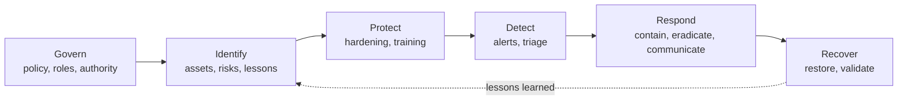

# Incident Response Lifecycle (Quick Reference)

Triage decides **whether** an alert is an incident. This page covers **what happens after**, so the hand-off from the SOC to incident response is clean. It follows NIST SP 800-61 Rev. 3 (2025), which places incident response inside the six CSF 2.0 functions rather than treating it as a separate cycle.

## The first 15 minutes of a confirmed incident

| Minute | Action | Owner |
|---|---|---|
| 0–5 | Declare the incident, assign an **incident lead**, open the ticket or war room, and start the timeline | SOC L2 / shift lead |
| 5–10 | **Contain the spread**: isolate hosts, disable or revoke accounts and sessions, block IOCs | SOC + IT ops |
| 10–15 | Notify per escalation matrix (IR, CISO, the asset owner); preserve volatile evidence before reimaging | Incident lead |

Contain first and investigate in depth afterwards. The goal is to stop the attacker getting further while evidence is still available.

## Respond: containment options by asset

| Asset | Short-term containment | Do not do |
|---|---|---|
| Endpoint / server | EDR network isolation (keeps telemetry) | Power off first. You lose memory |
| User account (cloud) | Revoke sessions, block sign-in, reset password, remove MFA methods the user didn't add | Reset the password only. Tokens survive |
| User account (AD) | Disable, reset the password, remove from privileged groups (domain compromise: reset krbtgt twice) | Delete the account. You lose its history |
| Cloud identity / key | Deactivate the key, remove role assignments, apply a deny policy | Delete before recording key IDs |
| Network IOC | Block at DNS, proxy and firewall together | Block one layer and assume done |
| SaaS / mailbox | Remove rules, forwarding, consents and links; purge messages | Delete the mailbox |

## Eradicate and recover

1. Remove every persistence mechanism found, then **hunt for the ones you did not find**: same hash, same task name, same IP, across the fleet.
2. Close the entry point: patch, fix the misconfiguration, enforce MFA.
3. Restore from known-good backups or rebuild; rotate credentials and secrets the attacker could reach.
4. Monitor the affected assets closely for 14–30 days and raise detection sensitivity for the IOCs.

## Communicate

- Keep a single timeline (UTC) and a single source of truth (the incident ticket).
- Involve legal and privacy early when personal or regulated data may be involved. Breach notification clocks can be short (GDPR: 72 hours to the supervisory authority after becoming aware).
- Use out-of-band channels if email or chat may be compromised.

## Lessons learned (within 2 weeks)

- What detected it, and how long it took (time to detect, time to contain).
- Which detections or playbooks were missing or slow. Turn each gap into a rule or playbook change.
- Which controls would have prevented it, with owners and dates.
