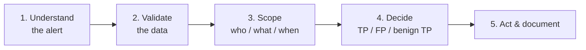

# The Universal Triage Method

Every playbook in this repo follows the same five steps. Learn them once and you can triage alerts you've never seen before.



## 1. Understand the alert (2 minutes)
- What behaviour does the rule detect, and **why is it bad**? (Read the rule's `description` and `false_positives`.)
- Which ATT&CK technique? Where does it sit in the kill chain - early (initial access) or late (impact)?

## 2. Validate the data (3 minutes)
- Is the event real and complete? (Parser issues create phantom alerts - check the raw log.)
- Are the key fields populated: user, host, IP, process, command line?

## 3. Scope - the 5 Ws (10 minutes)
| Question | Pivot |
|---|---|
| **Who** | User and its privileges, account type (human / service / admin) |
| **What** | Process, command, resource, data touched |
| **Where** | Host role (DC, server, laptop), network zone, cloud account |
| **When** | First seen, frequency, business hours? |
| **Why / How** | Parent process, preceding events in ±1h, entry vector |

Always check: **same indicator on other hosts / users?**

## 4. Decide
| Verdict | Meaning | Action |
|---|---|---|
| True positive | Malicious activity | Contain → escalate per [escalation matrix](escalation-and-handover.md) |
| Benign true positive | Rule worked, activity authorized (admin, pentest) | Document the approval; tune if recurring |
| False positive | Rule logic matched something it shouldn't | Close + open a tuning request for the detection team |

If you can't decide within 20 minutes on a HIGH/CRITICAL alert → escalate. Uncertainty is a reason to escalate, not to wait.

## 5. Act & document
Write the closure note so the next analyst never has to redo your work:

```
Verdict: <TP | BTP | FP>
Summary: <one sentence>
Evidence: <queries run, key findings>
Actions: <containment, tickets, notifications>
Tuning: <suggested exclusion or none>
```
