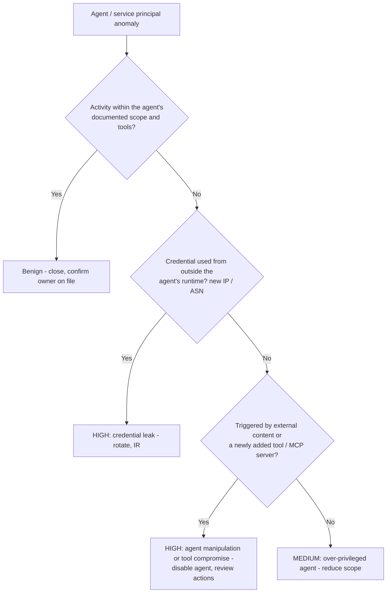

# AI Agent / Non-Human Identity Abuse

> AI agents (Copilot Studio agents, custom LangChain or MCP-based agents, coding agents) act through **service principals, API keys and OAuth grants**, often with broad permissions granted "to make it work". If the agent is manipulated (prompt injection), its tools are compromised (a malicious MCP server or plugin), or its credentials leak, the attacker gets an identity that **acts at machine speed and looks like automation**. Non-human identities already outnumber humans in most tenants.

## When this fires
- `entra_sp_signin_resource_fanout` (SecOps): One service principal (automation, integration or AI agent) signed in to five or more different resources within an hour
- `service-principal-new-resource-or-ip` (Sentinel): A service principal (including AI agents, automation and integrations) signed in successfully to a resource from an IP address it has not used with that resource in the previous 14 days

**Also hunt** for agent identities acting outside their declared purpose: new resources or APIs, unusual volume, permission changes, and consent grants to agent apps.

## Triage decision tree


## Investigation steps
1. Service principal activity by resource and IP, compared with a 30-day baseline:
   ```kql
   let lookback = 30d; let recent = 1d;
   let baseline = AADServicePrincipalSignInLogs
   | where TimeGenerated between (ago(lookback) .. ago(recent)) and ResultType == "0"
   | summarize by ServicePrincipalId, ResourceDisplayName, IPAddress;
   AADServicePrincipalSignInLogs
   | where TimeGenerated > ago(recent) and ResultType == "0"
   | join kind=leftanti baseline on ServicePrincipalId, ResourceDisplayName, IPAddress
   | summarize NewCombos = count(), Resources = make_set(ResourceDisplayName, 10), IPs = make_set(IPAddress, 10) by ServicePrincipalName, ServicePrincipalId
   | order by NewCombos desc
   ```
2. Permission and consent changes for agent apps: new Graph application permissions, delegated consents with `offline_access`, owners added ([app-only grant](../identity/app-only-permission-grant.md), [credential backdoor](../identity/app-credential-backdoor.md)).
3. Agent configuration: newly added tools, connectors or MCP servers (and who added them), system-prompt changes, and knowledge sources that include external content.
4. Reconstruct the agent's actions (tool-call logs, Graph activity, emails sent, files created), and identify the triggering input.

## True vs false positive

| Points to attack | Points to benign |
|---|---|
| Support agent's SP suddenly reads SharePoint finance sites | New capability rolled out with a change ticket |
| Agent API key used from a residential proxy | Agent scaled to a new region by the platform team |
| An unvetted MCP server added to a coding agent right before secrets were read | Approved tool from the internal catalogue |

## Containment & response
- Disable the agent or its service principal; rotate its secrets and keys; revoke OAuth grants.
- Review and undo its actions (emails sent, files shared, records changed).
- Govern agents like privileged identities: inventory with owners, least-privilege permissions, short-lived credentials (managed identity / workload federation), approved-tool allowlists, human-in-the-loop for high-impact actions, and full action logging.

## Escalation criteria
Credential leak, data access outside scope, or actions with business impact → IR.

## Evidence to collect
SP sign-ins, audit logs for permission changes, agent configuration history, tool-call / action logs, triggering input.
