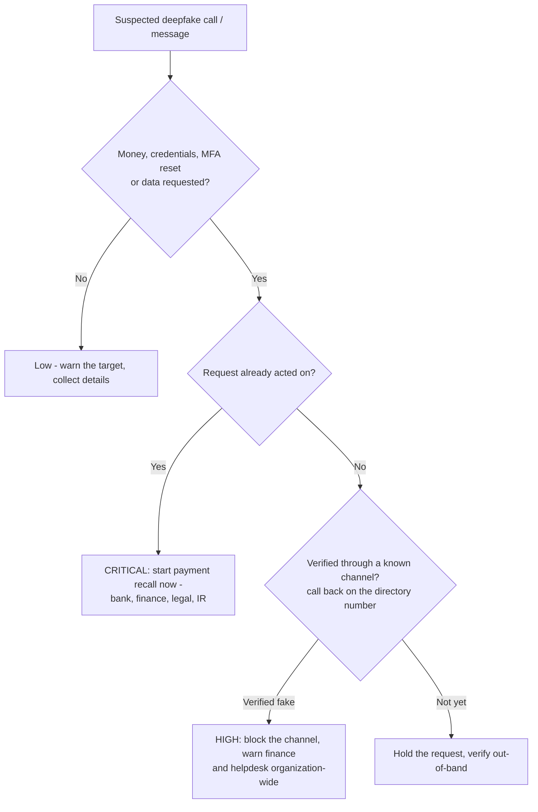

# Deepfake / AI-Enabled Social Engineering and Payment Fraud

> Cloned voices and real-time video deepfakes of executives now support classic fraud: an urgent transfer, a change to vendor bank details, an MFA reset for "the CFO who lost his phone". In one widely reported 2024 case, a finance employee paid out about **US$25 million** after a video call in which every other participant was a deepfake. The defence is **process, not detection**, but the SOC owns the response clock.

## When this fires
- `m365_teams_external_impersonation` / `teams-external-chat-impersonation`: an external tenant posing as an executive or IT, starting chats or calls
- `executive-display-name-impersonation`: email using an executive's display name from outside
- Reports from finance, the helpdesk or the user ("the call felt odd")

## Triage decision tree


## Investigation steps
1. Collect the channel details: external Teams tenant and user, phone numbers, meeting links, and email headers.
   ```kql
   OfficeActivity
   | where TimeGenerated > ago(7d) and OfficeWorkload == "MicrosoftTeams"
   | where Operation in ("ChatCreated", "MessageSent", "MemberAdded", "MeetingParticipantDetail")
   | where tostring(column_ifexists("CommunicationType", "")) != "" or UserId has "#EXT#" or tostring(column_ifexists("ParticipantInfo", "")) has "External"
   | project TimeGenerated, Operation, UserId, ChatName = tostring(column_ifexists("ChatName", "")), ClientIP
   ```
2. Identify every employee contacted by the same tenant, number or email, because these campaigns hit several people.
3. If a payment was made: the transaction reference, amount, beneficiary bank and time. **Recall windows are measured in hours.**
4. If an MFA reset or credential was given: follow [helpdesk social engineering](../identity/helpdesk-social-engineering.md).

## True vs false positive

| Points to fraud | Points to benign |
|---|---|
| Urgency and secrecy, new beneficiary account, executive "can't talk on the normal number" | Request through the normal approval workflow with known contacts |
| Video call where participants never interact naturally, or cameras glitch on movement | Executive's real external account, confirmed by call-back |
| Contact comes from a new external Teams tenant | Known partner tenant |

## Containment & response
- Payment fraud: contact the bank immediately for a recall, notify law enforcement and cyber insurance, and preserve evidence.
- Block the external tenant, domain or numbers; warn finance, the helpdesk and executive assistants with the actual details.
- Process controls (the real fix): out-of-band call-back on directory numbers for any payment or bank-detail change, dual approval above thresholds, code words for executives, and no MFA resets over voice alone.

## Escalation criteria
Any money moved, credentials or MFA changed, or several staff targeted → IR, finance and legal.

## Evidence to collect
Call or meeting metadata and recordings if any, chat transcripts, email headers, payment records, staff statements.
