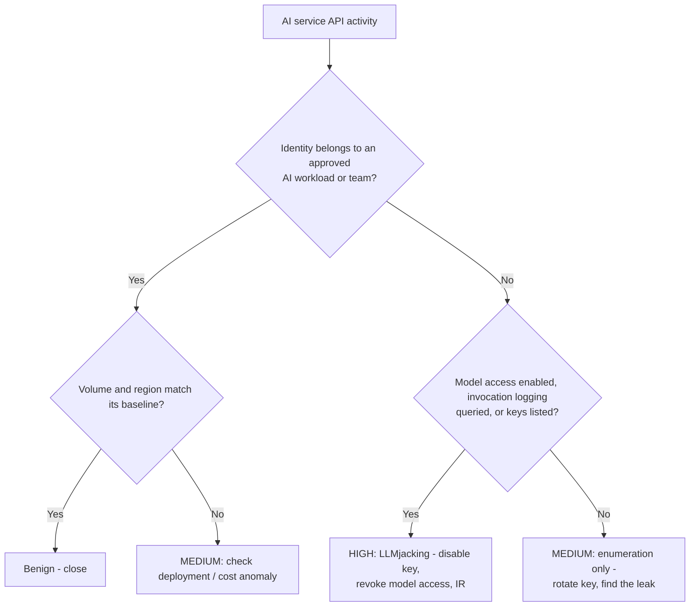

# LLMjacking: Stolen Credentials Used to Run AI Models

> Attackers use stolen cloud keys (from leaked repositories, infostealer logs or exposed `.env` files) to **switch on and resell access to paid AI models** such as Amazon Bedrock and Azure OpenAI. The victim pays: bills of tens of thousands of dollars per day are reported. The first API calls are recon, checking which models are enabled, which gives you a window to catch it early.

## When this fires
- `aws_bedrock_model_access_or_logging_probe` (SecOps): Amazon Bedrock model access enabled (PutUseCaseForModelAccess, CreateFoundationModelAgreement, PutFoundationModelEntitlement) or invocation logging probed / deleted - the LLMjacking playbook for reselling paid model access with stolen keys
- `azure_ai_service_keys_or_deployment` (SecOps): Azure AI services (Azure OpenAI / AI Foundry) keys listed or regenerated, or a model deployment created
- `aws-bedrock-model-access-or-llmjacking` (Sentinel): Bedrock model-access enablement (PutUseCaseForModelAccess, CreateFoundationModelAgreement, PutFoundationModelEntitlement), or GetModelInvocationLoggingConfiguration, the call attackers use to check whether prompts are logged before they resell access
- `azure-openai-keys-or-deployment-new-caller` (Sentinel): listKeys / regenerateKey or deployments/write on Microsoft.CognitiveServices (Azure OpenAI / AI Foundry) by a caller that has not performed these operations in the last 14 days

**Also hunt** daily for invocation volume by identity and region. Signals: model-availability and model-access APIs called by identities that never use AI services, invocation-logging checks, and Cognitive Services keys being listed.

## Triage decision tree


## Investigation steps
1. AWS Bedrock recon, enablement and invocation by identity:
   ```kql
   AWSCloudTrail
   | where TimeGenerated > ago(14d) and EventSource == "bedrock.amazonaws.com"
   | where EventName in ("InvokeModel", "InvokeModelWithResponseStream", "Converse", "ConverseStream", "GetModelInvocationLoggingConfiguration",
       "PutUseCaseForModelAccess", "CreateFoundationModelAgreement", "PutFoundationModelEntitlement", "ListFoundationModels", "GetFoundationModelAvailability")
   | summarize Calls = count(), Events = make_set(EventName, 20), Regions = make_set(AWSRegion, 10), Errors = countif(isnotempty(ErrorCode))
       by UserIdentityArn, SourceIpAddress, UserAgent
   | order by Calls desc
   ```
2. Azure OpenAI / AI Foundry: key listing and deployments by unexpected callers:
   ```kql
   AzureActivity
   | where TimeGenerated > ago(14d)
   | where OperationNameValue has "Microsoft.CognitiveServices/accounts"
   | where OperationNameValue has_any ("listKeys", "regenerateKey", "deployments/write", "raiPolicies")
   | project TimeGenerated, Caller, CallerIpAddress, OperationNameValue, _ResourceId, ActivityStatusValue
   ```
3. Find the leaked credential's origin: when was the key created, where is it used (CI, laptops), and was it pushed to a public repository ([source code exposure](../saas/source-code-secret-exposure.md)) or seen in infostealer logs?
4. Check cost and usage: billing anomaly alerts, tokens consumed per region, and newly enabled models.

## True vs false positive

| Points to attack | Points to benign |
|---|---|
| A CI deploy key suddenly calls `ListFoundationModels` and `InvokeModel` in five regions | The data-science role testing a new model with a ticket |
| `GetModelInvocationLoggingConfiguration` called before any invocation (checking if prompts are logged) | Platform team configuring invocation logging |
| Calls from VPS / residential proxy IPs with SDK user agents | Calls from the application's own VPC endpoint |

## Containment & response
- Deactivate the access key or regenerate Cognitive Services keys; remove model access granted during the window.
- Apply SCPs / Azure Policy restricting AI services to approved accounts, regions and models; prefer Entra ID / IAM role authentication over static API keys (disable local auth on Azure OpenAI).
- Enable model invocation logging and budget alerts on AI services.
- Contact the provider about fraudulent charges.

## Escalation criteria
Any confirmed invocation by an attacker, or exposure of keys with broader cloud permissions → IR.

## Evidence to collect
CloudTrail / Activity records, key IDs and their history, cost data, invocation logs if enabled, leak source.
