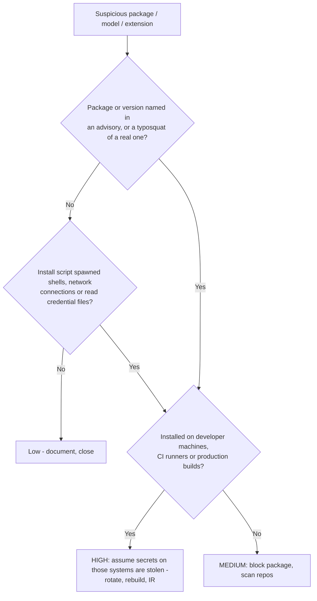

# Malicious Package, Model or Dev Tool (Software Supply Chain)

> Developers install hundreds of dependencies. Attackers publish **typosquatted or hijacked packages** (npm, PyPI, NuGet), poisoned **AI models** (pickle files that execute code on load), and malicious IDE extensions or AI-assistant plugins. Install scripts run with the developer's rights, on machines full of cloud keys, SSH keys and source code.

## When this fires
- `lnx_download_pipe_to_shell`, `win_execution_from_suspicious_folder`: install-time scripts fetching and running payloads
- `threat-intel-file-hash-match` / `rare-process-internet-connection`: known-bad package hash, or package-manager child processes talking to rare destinations
- Advisories: a package or extension you use is reported compromised (GitHub advisory, vendor alert)

## Triage decision tree


## Investigation steps
1. Package-manager processes and what they spawned:
   ```kql
   DeviceProcessEvents
   | where TimeGenerated > ago(7d)
   | where InitiatingProcessFileName in~ ("npm.exe", "node.exe", "pip.exe", "python.exe", "pip3", "node", "python3", "dotnet.exe", "code.exe")
   | where FileName in~ ("cmd.exe", "powershell.exe", "pwsh.exe", "bash", "sh", "curl", "curl.exe", "wget")
   | where ProcessCommandLine has_any ("http", "base64", "-enc", "/dev/tcp", ".ssh", ".aws", "credentials", "env")
   | project TimeGenerated, DeviceName, AccountName, InitiatingProcessCommandLine, FileName, ProcessCommandLine
   ```
2. Inventory where the package, version or extension exists: lockfiles across repositories (`package-lock.json`, `poetry.lock`), CI caches, container images and developer machines (EDR software inventory).
3. Determine what the install script did: read `~/.aws`, `~/.ssh`, `.npmrc` tokens or environment variables; exfiltrated to webhooks or paste sites; added persistence.
4. AI models: models loaded from public hubs in pickle format (`.pkl`, `.pt`, `.bin`) by notebooks or services. Prefer `safetensors`, and check whether the load spawned processes or network connections.

## True vs false positive

| Points to attack | Points to benign |
|---|---|
| `postinstall` script curls a payload and reads `~/.aws/credentials` | Native module build (node-gyp, compilers) during install |
| Package name one letter off a popular one, published days ago | Pinned, signed dependency from the internal mirror |
| Model file executes `os.system` on load | `safetensors` model from a vetted publisher |

## Containment & response
- Remove the package or extension, pin known-good versions, and block it in your internal registry or proxy.
- **Rotate every secret present on affected machines and CI runners** (cloud keys, Git tokens, npm / PyPI tokens, SSH keys), and rebuild runners.
- Check whether builds produced during the window shipped to customers, and if so treat it as a supply-chain incident.
- Harden: private registry or proxy with allowlisting and age delays, `npm ci --ignore-scripts` where possible, lockfile review, SBOMs, scanning of model files, and vetted IDE / AI-assistant extensions only.

## Escalation criteria
Execution on CI or production build systems, secrets stolen, or customer-facing artefacts affected → IR.

## Evidence to collect
Package name, version and hash; install logs; process and network events; list of affected hosts, repositories and builds; rotation records.
