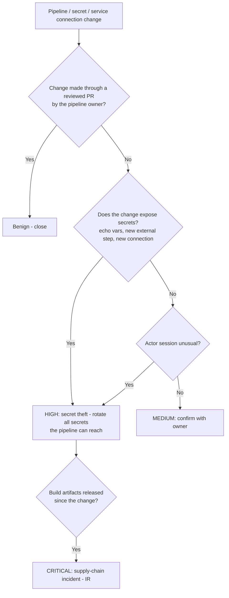

# CI/CD Pipeline and Secret Tampering

> Pipelines hold the keys to production: service connections, deployment credentials and signing keys. An attacker who edits a pipeline, adds a variable group or creates a service connection can **steal secrets or push a backdoored build** that every customer installs.

## When this fires
- `azure_devops_pipeline_or_secret_change` / `azure-devops-pipeline-and-secrets`: pipeline definition changes, variable group or secure file changes, new service connections, permission changes on pipelines, or Personal Access Tokens created with full scope
- `entra_federated_credential_added` / `entra-managed-identity-federated-credential`: a workload-identity federation trust (for example GitHub Actions OIDC) added to a cloud identity

## Triage decision tree


## Investigation steps
1. What changed in Azure DevOps, by whom, from where:
   ```kql
   AzureDevOpsAuditing
   | where TimeGenerated > ago(14d)
   | where Area in ("Pipelines", "Library", "Release", "Token", "Security") or OperationName has_any ("ServiceEndpoint", "VariableGroup", "SecureFile", "Pipeline", "Token")
   | project TimeGenerated, OperationName, ActorUPN, IpAddress, ProjectName, Details, Data
   ```
2. Diff the pipeline YAML: look for new steps that print or upload variables (`env`, `printenv`, `curl -d @…`), new external tasks or containers, and changed branches or triggers.
3. List the secrets the pipeline can reach (variable groups, Key Vault links, service connections) and check for use of the cloud identities behind them from new IPs.
4. For federated credentials: check the issuer and subject (repository, branch, environment). A subject that points to a fork or an external repository is a backdoor.
5. Check build outputs released after the change, and whether they are signed and reproducible.

## True vs false positive

| Points to attack | Points to benign |
|---|---|
| Pipeline edited directly on the default branch with no PR | Change merged through branch policy with reviewers |
| New service connection by a user outside DevOps admins | Platform team adding a connection with a ticket |
| Full-scope PAT created from a new IP | Short-lived PAT with limited scope for automation |

## Containment & response
- Revert the pipeline and disable compromised service connections and PATs.
- **Rotate every secret the pipeline could read**, and every cloud credential behind its service connections.
- If artefacts were released: pull them, notify consumers, and rebuild from a clean commit.
- Harden: branch protection with required reviews, pipeline permissions, OIDC federation scoped to protected branches, PAT policies, and audit streaming to the SIEM.

## Escalation criteria
Any unreviewed change exposing secrets, or a suspect artefact release → IR (possible supply-chain incident).

## Evidence to collect
Audit events, pipeline YAML before and after, run logs, the secret inventory, and the artefact hashes released.
