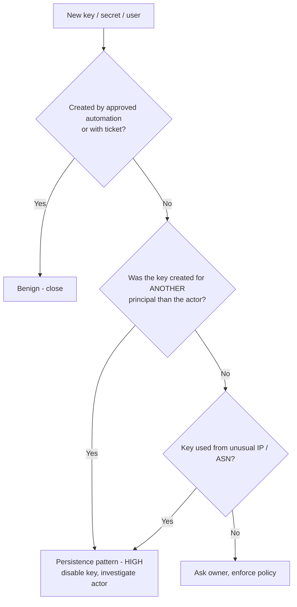

# New Long-Lived Cloud Credentials

> Access keys, service-account keys and app secrets are the #1 way attackers keep access to cloud accounts after the initial foothold is cleaned up.

## Triage decision tree


## Investigation steps
1. Actor vs target principal; source IP and user agent.
2. Has the new key been used? Search activity by the key / principal since creation:
   ```
   principal.user.userid = "<TARGET_PRINCIPAL>"
   ```
3. Permissions of the target principal - admin-equivalent keys are critical.
4. Was the actor itself compromised (recent console login from new location, MFA changes)?

## Containment & response
- Deactivate/delete the key or secret (keep the ID for hunting).
- Enforce `iam.disableServiceAccountKeyCreation` (GCP) / SCP denying `iam:CreateAccessKey` (AWS) except for break-glass.
- Prefer workload identity federation and short-lived tokens.

## Escalation criteria
Key for another principal, admin permissions, or usage from unknown infrastructure → IR.

## Evidence to collect
Creation event, key ID, actor activity, key usage log.
