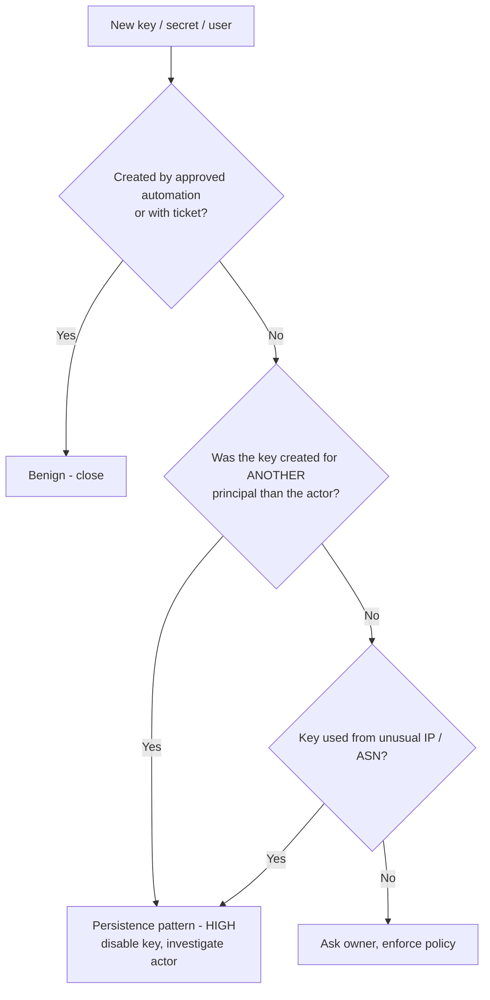

# New Long-Lived Cloud Credentials

> Access keys, service-account keys and app secrets are the #1 way attackers keep access to cloud accounts after the initial foothold is cleaned up.

## When this fires
- `aws_iam_access_key_created` (SecOps): A new IAM access key was created - long-lived credentials are the most common persistence mechanism in AWS breaches
- `aws_login_profile_changed` (SecOps): A console password was created or changed for an IAM user - attackers turn API-only users into console users
- `aws_iam_user_created` (SecOps): A new IAM user was created
- `gcp_service_account_key_created` (SecOps): A user-managed key was created for a GCP service account
- `entra_sp_credentials_added` (SecOps): New secret or certificate added to a service principal / app registration - the Solorigate-style backdoor
- `gcp-sa-key-or-owner-grant` (Sentinel): A user-managed service account key was created, or an IAM policy now grants roles/owner, roles/editor or iam.serviceAccountTokenCreator
- `entra-app-credential-added` (Sentinel): A client secret or certificate was added to an app registration or service principal

## Triage decision tree


## Investigation steps
1. Actor vs target principal; source IP and user agent.
2. Has the new key been used? Search activity by the key / principal since creation:
   ```
   principal.user.userid = "<TARGET_PRINCIPAL>"
   ```
3. Permissions of the target principal - admin-equivalent keys are critical.
4. Was the actor itself compromised (recent console login from new location, MFA changes)?

## True vs false positive

| Points to attack | Points to benign |
|---|---|
| Key created for a different principal than the actor | Rotation by the documented automation identity |
| New key used within minutes from a new ASN or region | Key created by its owner and used only from known CI runners |
| Actor recently authenticated from an unfamiliar location or without MFA | Created during onboarding of a new service with a ticket |

## Containment & response
- Deactivate/delete the key or secret (keep the ID for hunting).
- Enforce `iam.disableServiceAccountKeyCreation` (GCP) / SCP denying `iam:CreateAccessKey` (AWS) except for break-glass.
- Prefer workload identity federation and short-lived tokens.

## Escalation criteria
Key for another principal, admin permissions, or usage from unknown infrastructure → IR.

## Evidence to collect
Creation event, key ID, actor activity, key usage log.
