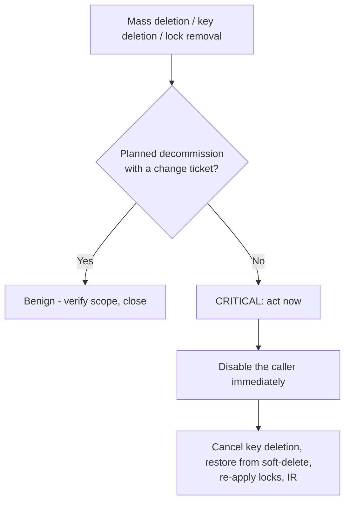

# Cloud Destructive Activity (Mass Deletion / Key Deletion)

> Cloud ransomware rarely encrypts disks. It **deletes backups and resources, schedules KMS keys for deletion, or overwrites blobs**, then demands payment. Resource locks being removed first is the tell. Minutes matter, because soft-delete windows are your recovery.

## When this fires
- `azure_mass_resource_deletion` / `azure-mass-resource-deletion`: one caller deletes many resources in a short window
- `azure_resource_lock_deleted` / `azure-resource-lock-deleted`: `Microsoft.Authorization/locks/delete`
- `aws_kms_key_deletion` / `aws-kms-key-deletion`: `ScheduleKeyDeletion` / `DisableKey`
- `azure_keyvault_deleted_or_policy_changed` / `azure-keyvault-deleted-or-purged`: vault deletion or purge
- `azure-storage-mass-delete-or-overwrite`: mass blob delete or overwrite (data-plane ransomware)

## Triage decision tree


## Investigation steps
1. Scope what is being destroyed, by whom:
   ```kql
   AzureActivity
   | where TimeGenerated > ago(1d)
   | where OperationNameValue endswith "/delete" or OperationNameValue has "locks/delete"
   | where ActivityStatusValue in ("Success", "Succeeded", "Started", "Accepted")
   | summarize Deletes = count(), Types = make_set(ResourceProviderValue, 20), Resources = make_set(_ResourceId, 100) by Caller, CallerIpAddress
   | order by Deletes desc
   ```
   ```kql
   AWSCloudTrail
   | where TimeGenerated > ago(1d)
   | where EventName in ("ScheduleKeyDeletion", "DisableKey", "DeleteBucket", "DeleteDBInstance", "DeleteDBCluster", "DeleteBackupVault", "DeleteRecoveryPoint", "TerminateInstances")
   | summarize Calls = count(), Events = make_set(EventName) by UserIdentityArn, SourceIpAddress
   ```
2. Check the backup plane first: Recovery Services / Backup vaults, AWS Backup, snapshots. Is the recovery path intact?
3. Look back to how the caller got its privileges ([privilege escalation](cloud-privilege-escalation.md)).

## True vs false positive

| Points to attack | Points to benign |
|---|---|
| Locks removed, then resources and backups deleted | IaC `destroy` on a dev environment from the pipeline |
| KMS keys scheduled for deletion outside a change | Planned key rotation retiring old keys |
| Caller from an unusual IP with a recent privilege grant | Decommission project with a ticket |

## Containment & response
- **Disable the caller now** (user, SP, access key), before investigating further.
- AWS KMS: `CancelKeyDeletion` (7–30 day window). Azure Key Vault: recover soft-deleted vaults, keys and secrets (purge protection should be on).
- Restore storage from soft-delete or versioning; restore VMs and databases from backup; re-apply resource locks.
- Prevent it: purge protection on Key Vault, Object Lock / immutable backups, MUA (multi-user authorization) on backup vaults, SCP denying `kms:ScheduleKeyDeletion` outside break-glass, and locks on production resource groups.

## Escalation criteria
Always escalate unplanned destruction to IR immediately, with leadership notification per your major-incident process.

## Evidence to collect
Activity / CloudTrail records, the list of deleted resources, recovery actions with their timestamps, and the caller's authentication history.
