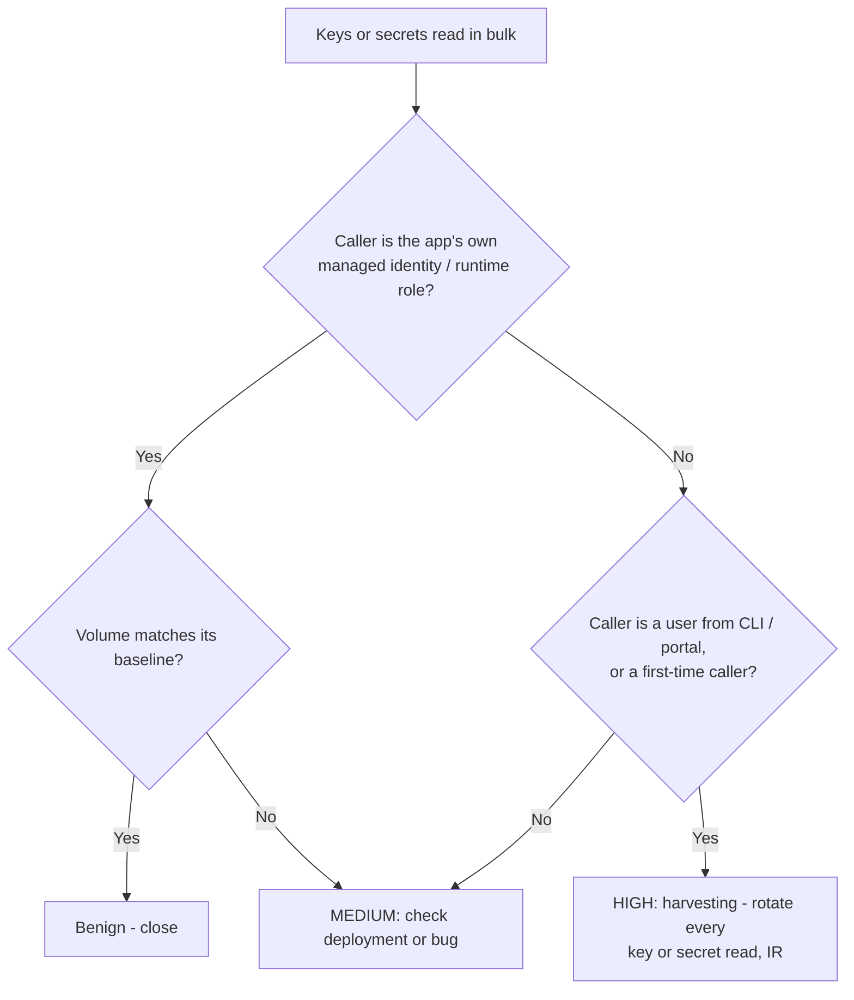

# Cloud Key and Secret Harvesting

> Storage account keys, Cosmos DB / Service Bus connection strings, Key Vault secrets and AWS Secrets Manager values are **credentials that bypass Entra ID, MFA and Conditional Access**. An attacker who reads them keeps access even after you lock the user out.

## When this fires
- `azure_access_keys_harvesting` / `azure-access-keys-harvesting`, `azure_storage_keys_listed`: `listKeys`, `regenerateKey`, `listConnectionStrings` across storage, Cosmos DB, Service Bus, Event Hubs, Redis and similar services
- `azure_keyvault_mass_secret_access` / `azure-keyvault-secret-access-new-caller` / `azure-keyvault-access-denied-burst`: many `SecretGet` calls, a first-time caller, or a burst of denied attempts
- `aws_secrets_mass_retrieval` / `aws-secrets-mass-retrieval`: `GetSecretValue` on many secrets by one identity

## Triage decision tree


## Investigation steps
1. Azure control plane: which keys were listed, by whom:
   ```kql
   AzureActivity
   | where TimeGenerated > ago(7d)
   | where OperationNameValue has_any ("listKeys", "regenerateKey", "listConnectionStrings", "listAdminCredential")
   | summarize Calls = count(), Resources = make_set(_ResourceId, 50) by Caller, CallerIpAddress
   | order by Calls desc
   ```
2. Key Vault data plane: which secrets, which caller, from where:
   ```kql
   AzureDiagnostics
   | where TimeGenerated > ago(7d) and ResourceProvider == "MICROSOFT.KEYVAULT"
   | where OperationName in ("SecretGet", "SecretList", "KeyGet", "CertificateGet")
   | extend Caller = column_ifexists("identity_claim_upn_s", ""), CallerApp = column_ifexists("identity_claim_appid_g", "")
   | summarize Ops = count(), Secrets = dcount(column_ifexists("id_s", "")) by Resource, Caller, CallerApp, CallerIPAddress, ResultSignature
   ```
3. AWS: `GetSecretValue`, `BatchGetSecretValue` and `GetParameter` with `WithDecryption`, grouped by identity and IP.
4. Map each secret to what it unlocks (database, SaaS API and so on) and check those systems for use from new IPs.

## True vs false positive

| Points to harvesting | Points to benign |
|---|---|
| A user lists keys on 10+ resources from the CLI in minutes | Function App identity reading its own secrets at start-up |
| First-time caller reading many secrets | Deployment pipeline during a release window |
| Bursts of `403` on secrets the caller has no access to, followed by success | Backup tool with a documented pattern |

## Containment & response
- **Rotate every key and secret that was read** (regenerate storage keys, rotate connection strings and secrets), then update the consuming apps.
- Disable the caller's credentials; review its other actions.
- Disable shared-key authorization on storage accounts where possible (`allowSharedKeyAccess=false`), use Entra ID / managed identities, and use Key Vault RBAC with PIM for humans.
- Alert on any human `listKeys` outside pipelines.

## Escalation criteria
Bulk reads by a human or an unknown identity, or keys used afterwards from new infrastructure → IR.

## Evidence to collect
Activity and Key Vault logs, the list of keys and secrets read, rotation records, and downstream usage logs.
