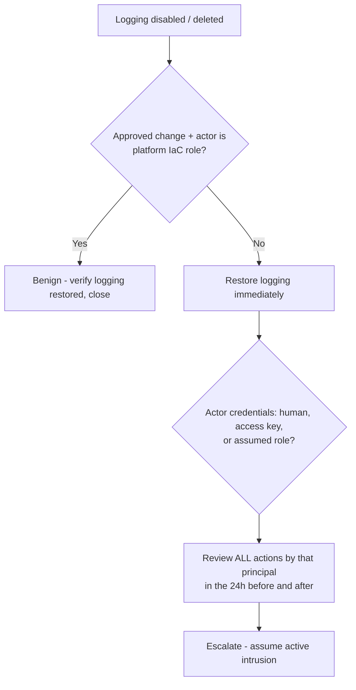

# Cloud Audit Logging Tampering

> Someone switched off the cameras. Treat every logging disablement as hostile until a change ticket says otherwise, and assume you are now partially blind.

## Triage decision tree


## Investigation steps
1. Identify the principal, source IP, user agent (CLI, console, SDK) and region.
2. Everything else that principal did (the tampering usually happens just before the real objective):
   ```
   principal.user.userid = "<ACTOR>"
   ```
3. Check other regions/accounts/projects - attackers often operate in unused regions.
4. Which telemetry is still available? (Org-level trails, Config aggregators, GuardDuty in delegated admin, SIEM ingestion gap.)

## Containment & response
- Re-enable logging (CloudTrail `StartLogging`, recreate diagnostic settings / sinks).
- Disable the access key or revoke sessions of the principal; for roles, attach a deny-all inline policy.
- Enforce SCPs / Org policies that deny logging changes except from break-glass roles.

## Escalation criteria
No approval → always IR.

## Evidence to collect
Audit events, principal details, timeline of the logging gap, list of actions by the principal.
