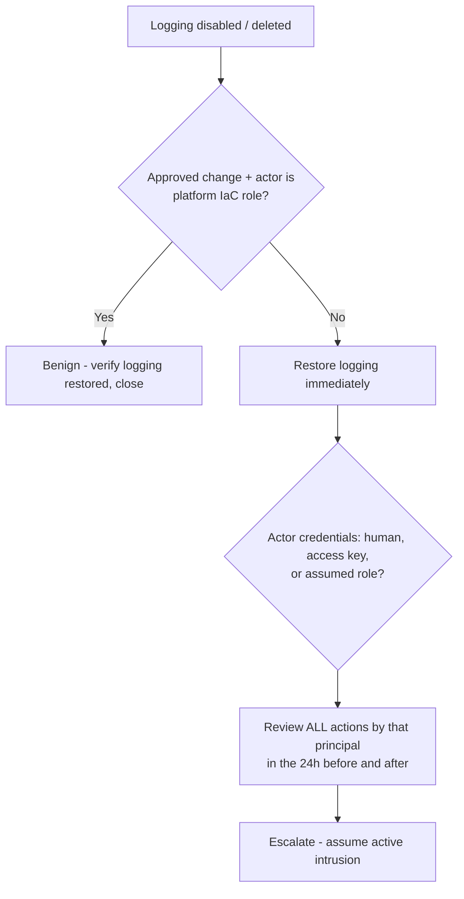

# Cloud Audit Logging Tampering

> Someone switched off the cameras. Treat every logging disablement as hostile until a change ticket says otherwise, and assume you are now partially blind.

## When this fires
- `aws_cloudtrail_tampering` (SecOps): CloudTrail logging stopped, a trail deleted or its event selectors changed - attackers cut audit visibility before acting
- `aws_guardduty_disabled` (SecOps): GuardDuty detector deleted/updated, members disassociated or a suppression filter created
- `aws_vpc_flow_logs_deleted` (SecOps): VPC Flow Logs deleted - removes network visibility
- `aws_config_recorder_stopped` (SecOps): AWS Config recorder stopped or deleted, or delivery channel/rules removed
- `aws_cloudwatch_logs_deleted` (SecOps): CloudWatch log groups or streams deleted - evidence destruction
- `azure_diagnostic_setting_deleted` (SecOps): A diagnostic setting was deleted - stops logs flowing to the SIEM / Log Analytics
- `gcp_logging_sink_tampering` (SecOps): A Cloud Logging sink or log bucket was deleted or modified, or a log exclusion was created
- `m365_audit_config_changed` (SecOps): Admin audit log configuration or mailbox audit bypass changed - can stop audit logging (used by APT29)
- `aws-cloudtrail-or-guardduty-disabled` (Sentinel): StopLogging, DeleteTrail, PutEventSelectors, DeleteDetector, DisassociateFromMasterAccount, StopConfigurationRecorder and friends
- `azure-diagnostic-setting-deleted` (Sentinel): A diagnostic setting was deleted, which stops resource logs flowing to Log Analytics / Sentinel
- `gcp-logging-or-firewall-weakened` (Sentinel): A Cloud Logging sink deleted/updated, or a VPC firewall rule allowing 0.0.0.0/0
- `defender-for-cloud-plan-disabled` (Sentinel): A Defender for Cloud plan was switched to the Free tier (Microsoft.Security/pricings/write with pricingTier Free)
- `mailbox-audit-bypass-or-disabled` (Sentinel): Set-Mailbox -AuditEnabled $false, Set-MailboxAuditBypassAssociation or changes to the admin audit log configuration

## Triage decision tree


## Investigation steps
1. Identify the principal, source IP, user agent (CLI, console, SDK) and region.
2. Everything else that principal did (the tampering usually happens just before the real objective):
   ```
   principal.user.userid = "<ACTOR>"
   ```
3. Check other regions/accounts/projects - attackers often operate in unused regions.
4. Which telemetry is still available? (Org-level trails, Config aggregators, GuardDuty in delegated admin, SIEM ingestion gap.)

## True vs false positive

| Points to attack | Points to benign |
|---|---|
| Trail stopped or sink deleted with no change ticket | Migration to an organization trail or a central sink |
| Followed by privileged or destructive actions in the blind window | IaC pipeline recreating the resource in the same minute |
| Actor rarely manages logging | Cost-reduction change approved by the platform team |

## Containment & response
- Re-enable logging (CloudTrail `StartLogging`, recreate diagnostic settings / sinks).
- Disable the access key or revoke sessions of the principal; for roles, attach a deny-all inline policy.
- Enforce SCPs / Org policies that deny logging changes except from break-glass roles.

## Escalation criteria
No approval → always IR.

## Evidence to collect
Audit events, principal details, timeline of the logging gap, list of actions by the principal.
