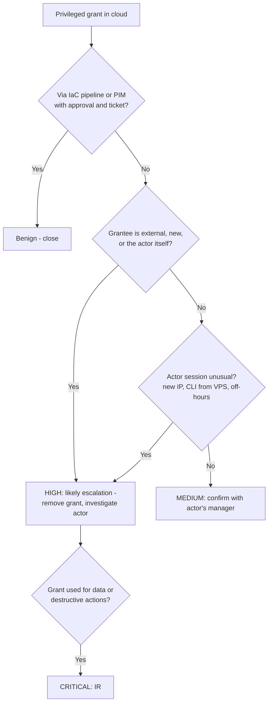

# Cloud Privilege Escalation (Role / Policy Grant)

> Owner / Contributor / User Access Administrator in Azure, `AdministratorAccess` or a permissive trust policy in AWS, Owner or `iam.serviceAccountTokenCreator` in GCP: **one grant turns a foothold into control of the cloud estate**. Global Admins can also "elevate access" to every Azure subscription with one click.

## When this fires
- `azure_role_assignment_created` / `azure-role-assignment-created`: privileged RBAC role assigned at subscription or management-group scope
- `azure_elevate_access` / `azure-elevate-access`: `Microsoft.Authorization/elevateAccess/action` (User Access Administrator at root `/`)
- `aws_iam_policy_attached`, `aws_role_trust_policy_updated` / `aws-iam-privilege-escalation`: admin policy attached, inline policy with `*:*`, or a role trust policy opened to another account or principal
- `gcp_iam_policy_changed` / `gcp-sa-key-or-owner-grant`: Owner/Editor or token-creator bindings added

## Triage decision tree


## Investigation steps
1. Azure: who granted which role to whom, at what scope:
   ```kql
   AzureActivity
   | where TimeGenerated > ago(7d)
   | where OperationNameValue in~ ("Microsoft.Authorization/roleAssignments/write", "Microsoft.Authorization/elevateAccess/action")
   | where ActivityStatusValue in ("Success", "Succeeded")
   | extend Props = parse_json(Properties)
   | project TimeGenerated, Caller, CallerIpAddress, OperationNameValue, Scope = tostring(Props.entity), RequestBody = tostring(Props.requestbody)
   ```
   Map the `roleDefinitionId` in the request body to the role name. Owner, Contributor and User Access Administrator are the ones that matter most.
2. AWS: show the policy change and the actor:
   ```kql
   AWSCloudTrail
   | where TimeGenerated > ago(7d)
   | where EventName in ("AttachUserPolicy", "AttachRolePolicy", "AttachGroupPolicy", "PutUserPolicy", "PutRolePolicy", "UpdateAssumeRolePolicy", "CreatePolicyVersion")
   | project TimeGenerated, EventName, UserIdentityArn, SourceIpAddress, UserAgent, RequestParameters, ErrorCode
   ```
3. Check whether the new privilege was used: actions by the grantee after the grant (resource reads, key listing, deletions).
4. Review the actor's authentication: console login without MFA, access key from a new ASN, a recently created access key.
5. SecOps pivot:
   ```
   metadata.product_event_type = /roleAssignments\/write|AttachUserPolicy|AttachRolePolicy|SetIamPolicy/ AND principal.user.userid = "<ACTOR>"
   ```

## True vs false positive

| Points to attack | Points to benign |
|---|---|
| Actor grants itself or a new identity Owner / AdministratorAccess | Terraform / Bicep pipeline identity with a PR |
| Trust policy now allows an unknown external account | Cross-account role for an approved vendor |
| `elevateAccess` by a Global Admin who never manages Azure | PIM activation with justification and approval |

## Containment & response
- Remove the grant (and any `elevateAccess`, then remove root-scope User Access Administrator).
- Disable or rotate the actor's credentials; revoke sessions.
- Review everything the grantee did since the grant.
- Enforce PIM / just-in-time access, SCPs or Azure Policy denying admin-policy attachment outside pipelines, and alerts on every root-scope grant.

## Escalation criteria
Unapproved privileged grant, especially if then used → IR.

## Evidence to collect
Activity / CloudTrail records with request parameters, actor authentication history, and grantee activity after the grant.
