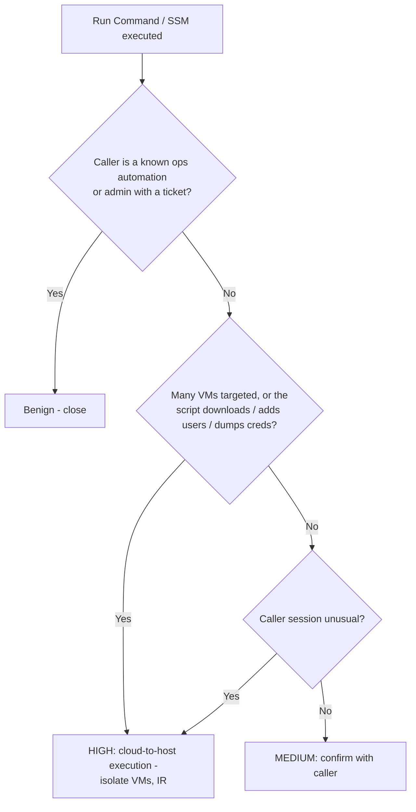

# Remote Command on Cloud VM (Run Command / SSM)

> Azure Run Command and AWS Systems Manager let anyone with the right cloud role **run scripts as SYSTEM / root on every VM**, with no network path and no VM credentials needed. To an attacker holding cloud admin, this is a built-in remote-execution tool.

## When this fires
- `azure_vm_run_command` / `azure-vm-run-command`: `Microsoft.Compute/virtualMachines/runCommand/action` or `runCommands/write`
- `aws_ssm_remote_command`: `SendCommand` / `StartSession` from an unusual identity, or with `AWS-RunShellScript` / `AWS-RunPowerShellScript` on many instances

## Triage decision tree


## Investigation steps
1. Who ran commands, on which VMs:
   ```kql
   AzureActivity
   | where TimeGenerated > ago(7d) and OperationNameValue has "runCommand"
   | summarize Runs = count(), VMs = make_set(_ResourceId, 50) by Caller, CallerIpAddress, ActivityStatusValue
   ```
2. Get the **script content**. On Windows VMs it is under `C:\Packages\Plugins\Microsoft.CPlat.Core.RunCommandWindows\…\Downloads`, and on Linux under `/var/lib/waagent/run-command/download/`. For AWS, read the SSM command document and parameters (`aws ssm list-commands`) or the session logs.
3. Check the VM-side effects in EDR: new users, services, downloads, or credential dumping by the Run Command handler process.
4. Review how the caller got `Virtual Machine Contributor` / `ssm:SendCommand` ([privilege escalation](cloud-privilege-escalation.md)).

## True vs false positive

| Points to attack | Points to benign |
|---|---|
| A user who never manages VMs runs a script across 30 VMs | Patch or config automation account |
| Script downloads a binary or creates a local admin | Support engineer resetting RDP config with a ticket |
| Caller authenticated from a new country | Scheduled SSM maintenance window |

## Containment & response
- Disable the caller and remove its roles; isolate affected VMs if the script was malicious.
- Remove what the script created (users, services, binaries); rebuild if root or SYSTEM compromise is confirmed.
- Restrict Run Command / SSM to a small group with PIM; log SSM sessions to S3 / CloudWatch; alert on every human-initiated Run Command.

## Escalation criteria
A malicious script, or execution across many VMs or on tier-0 servers → IR.

## Evidence to collect
Activity / CloudTrail records, the script content, VM EDR timelines, and the caller's history.
