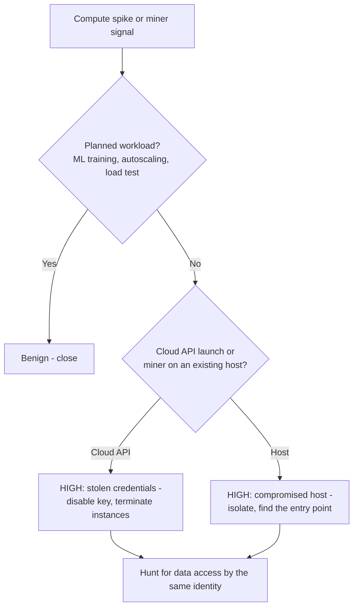

# Cryptojacking / Compute Abuse

> Stolen cloud keys are often monetized by launching large GPU or compute fleets in unused regions, and compromised Linux hosts and containers get a miner dropped on them. The cost can reach **tens of thousands per day**, and the access used is usually also good for data theft.

## When this fires
- `aws_ec2_mass_instance_launch` / `aws-ec2-mass-launch`: many `RunInstances` by one identity, GPU instance types, or regions never used before
- `azure_gpu_or_mass_vm_creation` / `azure-vm-mass-or-gpu-creation`: bursts of VM / scale-set creation or GPU SKUs
- `lnx_crypto_miner` / `crypto-miner`, `umb_cryptomining_domain`: xmrig-style processes, `stratum+tcp` pool connections, or DNS to mining pools

## Triage decision tree


## Investigation steps
1. AWS: instance launches by identity, region and type:
   ```kql
   AWSCloudTrail
   | where TimeGenerated > ago(3d) and EventName == "RunInstances" and isempty(ErrorCode)
   | extend InstanceType = tostring(parse_json(RequestParameters).instanceType)
   | summarize Launches = count(), Types = make_set(InstanceType), Regions = make_set(AWSRegion) by UserIdentityArn, SourceIpAddress
   | order by Launches desc
   ```
2. Azure: VM and scale-set writes with their SKUs (`Microsoft.Compute/virtualMachines/write`, `virtualMachineScaleSets/write`), by Caller and IP.
3. On hosts: process with high CPU and pool connections. Check the command line for `--donate-level`, `-o pool:port`, `stratum`, and persistence (cron, systemd).
4. Check how the credential leaked: a key committed to a public repository, an exposed CI variable, or an SSRF to instance metadata.

## True vs false positive

| Points to abuse | Points to benign |
|---|---|
| GPU instances in a region the organization never uses | Data-science team's planned training run |
| Launches from a key that normally only reads S3 | Autoscaling group reacting to load |
| `xmrig` binary in `/tmp` and connections to a mining pool | Approved blockchain research environment |

## Containment & response
- Disable or delete the access key or credential, terminate unknown instances (snapshot one first for forensics), and remove any IAM users or keys created.
- Hosts: isolate, kill the miner, remove persistence, patch the entry point, and preferably rebuild.
- Prevent it: SCPs restricting regions and instance families, quota alerts and budget alerts, and AWS / Azure cost anomaly detection.
- Open a case with the cloud provider for billing review.

## Escalation criteria
Cloud credential abuse (always), or miners on production servers or Kubernetes nodes → IR.

## Evidence to collect
Launch events, instance IDs and AMIs, miner binary and config, the wallet address, cost data, and the credential's history.
