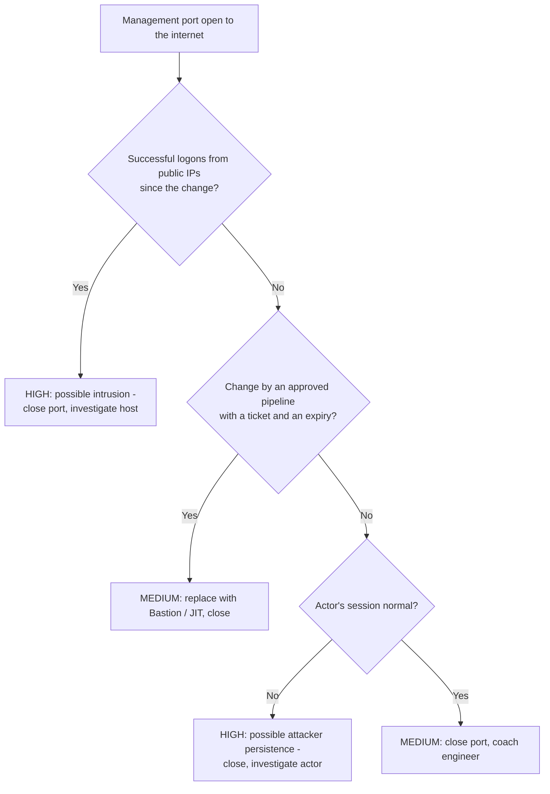

# Management Ports Exposed to the Internet

> A firewall rule allowing `0.0.0.0/0` to RDP (3389), SSH (22), WinRM, SMB or a database port is found by internet scanners **within minutes**, and brute-forced within hours. Often someone opened it "temporarily" for troubleshooting. Attackers with cloud access also open ports on purpose to create a way back in.

## When this fires
- `azure_nsg_rule_modified` / `azure-nsg-management-port-open`, `aws_security_group_ingress_change` / `aws-security-group-open-world`, `gcp_firewall_rule_modified`: inbound rules from any source to management or database ports
- `net_rdp_from_internet`, `net_admin_ports_from_internet` / `rdp-logon-from-public-ip`, `exposed-admin-services-inbound`: inbound management traffic or logons from public IPs

## Triage decision tree


## Investigation steps
1. Rule changes and who made them (Azure example):
   ```kql
   AzureActivity
   | where TimeGenerated > ago(7d)
   | where OperationNameValue has_any ("networkSecurityGroups/securityRules/write", "networkSecurityGroups/write")
   | where ActivityStatusValue in ("Success", "Succeeded")
   | extend Rule = tostring(parse_json(Properties).requestbody)
   | where Rule has_any ("\"*\"", "0.0.0.0/0", "Internet", "Any") and Rule has_any ("3389", "22", "5985", "5986", "445", "1433", "3306", "5432", "*")
   | project TimeGenerated, Caller, CallerIpAddress, _ResourceId, Rule
   ```
2. What reached the exposed host since the change: inbound connections (NSG flow logs / VPC flow logs), failed and successful logons (4624/4625 type 10, sshd), and source reputation.
3. If any public-IP logon succeeded: treat the host as compromised ([brute force success](../identity/brute-force-success.md)).
4. Check the actor ([cloud privilege escalation](cloud-privilege-escalation.md)) if the change wasn't expected.

## True vs false positive

| Points to attack | Points to benign |
|---|---|
| Rule opened by an identity that rarely changes networking, from a new IP | Pipeline change with a ticket, scoped to the vendor's IP |
| Successful RDP from abroad after the change | Load balancer health probes |
| Port reopened right after being closed | Honeypot by the security team (documented) |

## Containment & response
- Close the rule (restrict it to known IPs or remove it). If logons succeeded, isolate the host and reset local and domain credentials used there.
- Replace direct exposure with Azure Bastion / AWS SSM Session Manager / IAP, or just-in-time VM access.
- Prevent with policy: Azure Policy / AWS Config / GCP org policy denying management ports from `0.0.0.0/0`, with automatic remediation.

## Escalation criteria
Successful logons from the internet, or a deliberate opening by a suspicious identity → IR.

## Evidence to collect
Rule change records, flow logs, logon events on the host, actor history.
