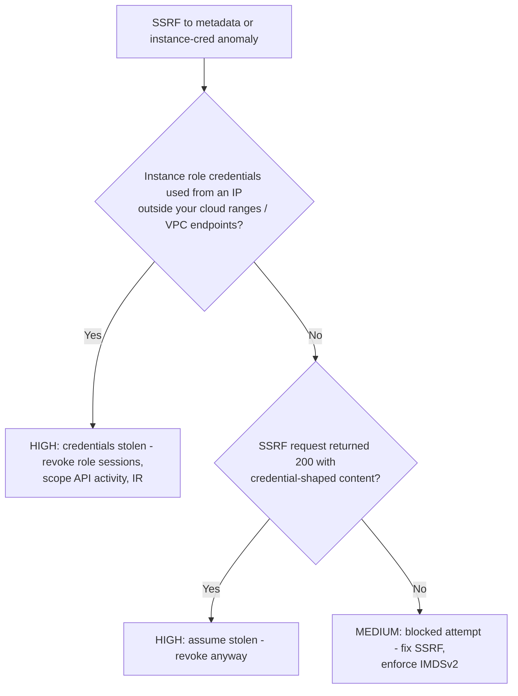

# Instance Metadata Credential Theft (SSRF / IMDS)

> Every cloud VM and container can ask the metadata service (`169.254.169.254`) for **temporary credentials of its role**. An SSRF bug in a web app, or a shell on the host, returns those credentials to the attacker, who then uses them **from their own machine**. The giveaway is an instance role's credentials being used from an IP that is not that instance.

## When this fires
- `web_ssrf_cloud_metadata` / `web-exploit-patterns-in-url`: requests containing `169.254.169.254`, `metadata.google.internal`, `/latest/meta-data/iam/` or `metadata/identity/oauth2/token` in parameters
- AWS GuardDuty `UnauthorizedAccess:IAMUser/InstanceCredentialExfiltration.OutsideAWS` / `.InsideAWS`
- Hunt below: an instance role session used from a non-instance IP

## Triage decision tree


## Investigation steps
1. AWS: assumed-role sessions named after an instance ID, used from unexpected IPs:
   ```kql
   AWSCloudTrail
   | where TimeGenerated > ago(7d)
   | where UserIdentityType == "AssumedRole" and UserIdentityArn matches regex @"assumed-role/[^/]+/i-[0-9a-f]+"
   | where not(ipv4_is_private(SourceIpAddress)) and SourceIpAddress !endswith ".amazonaws.com"
   | summarize Calls = count(), Events = make_set(EventName, 30), First = min(TimeGenerated) by UserIdentityArn, SourceIpAddress, UserAgent
   | order by First asc
   ```
   Compare `SourceIpAddress` with the instance's own public IP or NAT gateway. A mismatch means the credentials were used elsewhere.
2. Find the SSRF: web / WAF logs on the instance's application for metadata URLs in parameters, and the response sizes.
3. Scope what the role can do and what the attacker did with it (S3 reads, `GetSecretValue`, `AssumeRole` chaining).
4. Azure / GCP equivalents: managed identity tokens used from unexpected IPs (sign-in logs for managed identities), and service-account token use from outside GCP.

## True vs false positive

| Points to attack | Points to benign |
|---|---|
| Instance role used from a VPS while the instance has a different egress IP | Calls via the account's own NAT gateway |
| SSRF request with `/iam/security-credentials/` returning 200 | Security scanner probe blocked by IMDSv2 (401) |
| `ListBuckets` followed by mass `GetObject` from the new IP | Instance using VPC endpoints (private IPs) |

## Containment & response
- Revoke active sessions for the role (an IAM policy denying tokens issued before now, `aws:TokenIssueTime`) and rotate any secrets the role could read.
- Fix the SSRF; **require IMDSv2** (`HttpTokens=required`, hop limit 1 for containers), and use the IMDSv2-required account default.
- Add `aws:SourceVpc` / `aws:SourceIp` conditions to sensitive role policies, and enable GuardDuty.

## Escalation criteria
Any confirmed off-instance use of role credentials → IR.

## Evidence to collect
CloudTrail for the role session, WAF / application logs with the SSRF requests, GuardDuty finding, list of resources accessed.
