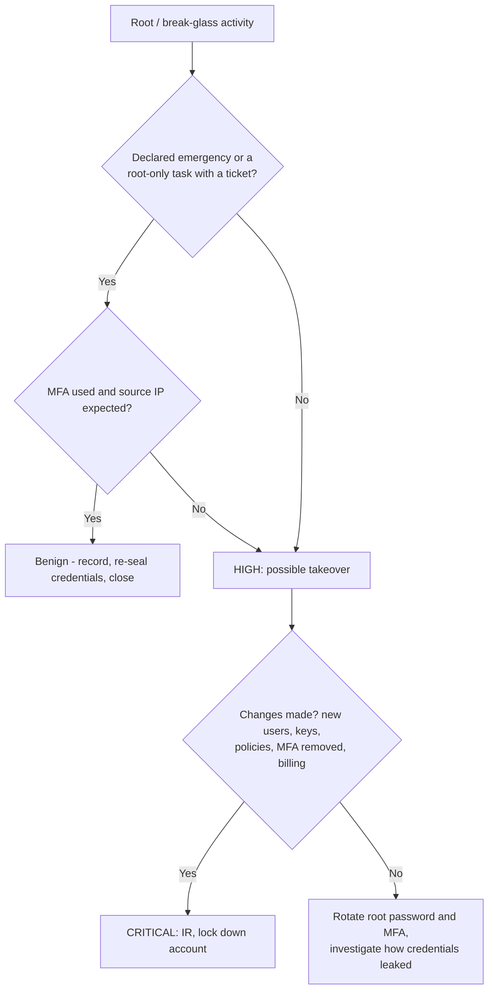

# Root / Break-Glass Account Usage

> The AWS root user and emergency ("break-glass") accounts bypass normal controls by design. **Any use should map to a declared emergency or a short list of root-only tasks.** Everything else is a potential takeover, and root compromise means total account compromise.

## When this fires
- `aws_root_account_usage` / `aws-root-or-console-without-mfa`: API or console activity by `Root`, or a console login without MFA
- `aws_mfa_deactivated`: MFA device deactivated or deleted for a user or root

## Triage decision tree


## Investigation steps
1. All root activity in the window:
   ```kql
   AWSCloudTrail
   | where TimeGenerated > ago(30d) and UserIdentityType == "Root"
   | summarize Calls = count(), Events = make_set(EventName, 50), First = min(TimeGenerated), Last = max(TimeGenerated)
       by SourceIpAddress, UserAgent, RecipientAccountId
   ```
2. Check `ConsoleLogin` additional data for `MFAUsed` and the login result.
3. Review changes: `CreateUser`, `CreateAccessKey`, `DeactivateMFADevice`, `PutBucketPolicy`, `UpdateAccountPassword`, and changes to the contact or billing details.
4. Verify who holds the root credentials (sealed envelope or password-manager vault access log).
5. SecOps pivot:
   ```
   metadata.vendor_name = "AMAZON" AND principal.user.userid = /root/ nocase
   ```

## True vs false positive

| Points to takeover | Points to benign |
|---|---|
| Root API calls from an unknown IP, no ticket | Closing an account, changing the support plan (root-only tasks) |
| MFA deactivated, then a root login | Annual break-glass test with a recorded procedure |
| New IAM admin user created by root | Root used by the cloud team lead during a declared outage |

## Containment & response
- Reset the root password, replace the MFA device (hardware key) and delete any root access keys.
- Remove users, keys and policies created during the session; check billing for crypto-mining resources.
- In AWS Organizations, use centralized root access management to remove member-account root credentials, and SCPs to deny root actions.
- Store break-glass credentials split or sealed, and alert on every use.

## Escalation criteria
Any unplanned root or break-glass use → IR immediately.

## Evidence to collect
CloudTrail root events, the console login record, the changes made, and the credential custody log.
