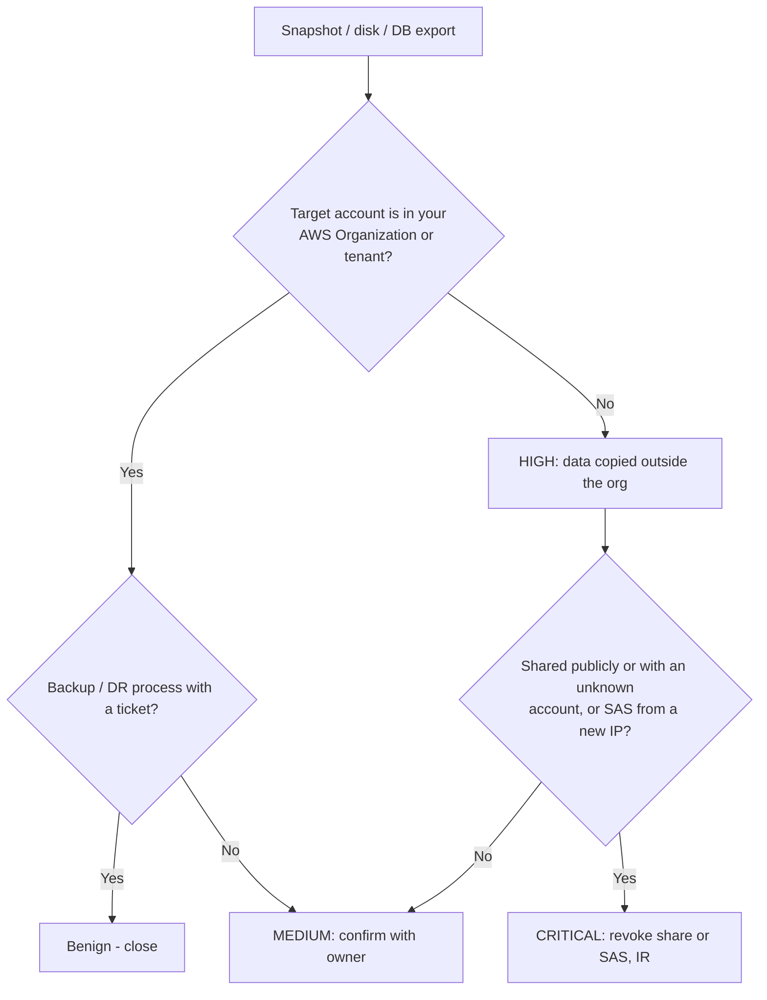

# Cloud Snapshot, Disk or Database Export

> Sharing an EBS snapshot or AMI with another account, generating a SAS URL for a managed disk, or exporting a database to storage **copies the entire dataset in one API call**, without touching the network perimeter or DLP.

## When this fires
- `aws_snapshot_or_ami_shared` / `aws-snapshot-or-ami-shared`: `ModifySnapshotAttribute` / `ModifyImageAttribute` / `ModifyDBSnapshotAttribute` adding a `createVolumePermission` or `restore` for an external account or `all`
- `azure_database_or_disk_export` / `azure-database-or-disk-export`: `Microsoft.Compute/disks/beginGetAccess/action` (disk SAS export), snapshot SAS, or SQL `export` actions

## Triage decision tree


## Investigation steps
1. AWS: who shared which snapshot, and with whom:
   ```kql
   AWSCloudTrail
   | where TimeGenerated > ago(14d)
   | where EventName in ("ModifySnapshotAttribute", "ModifyImageAttribute", "ModifyDBSnapshotAttribute", "ModifyDBClusterSnapshotAttribute", "CopySnapshot")
   | project TimeGenerated, EventName, UserIdentityArn, SourceIpAddress, RequestParameters, RecipientAccountId
   ```
   Look in `RequestParameters` for account IDs outside your Organization, or for `"group":"all"` (public).
2. Azure: disk or snapshot SAS generation and database exports:
   ```kql
   AzureActivity
   | where TimeGenerated > ago(14d)
   | where OperationNameValue has_any ("disks/beginGetAccess", "snapshots/beginGetAccess", "databases/export", "managedInstances/databases/export")
   | project TimeGenerated, Caller, CallerIpAddress, OperationNameValue, _ResourceId, ActivityStatusValue
   ```
3. Identify the data: which workloads the disk or snapshot came from, and whether they hold regulated data.
4. Check the actor's authentication and other recent actions (privilege grants, key creation).

## True vs false positive

| Points to theft | Points to benign |
|---|---|
| Share with an AWS account outside the Organization | Cross-account copy to the backup account in the Org |
| Disk SAS generated from a VPS IP | Azure Site Recovery / backup service principal |
| Followed by deletion of the source snapshot | Scheduled DB export to a corporate storage account |

## Containment & response
- Remove the sharing permission, or revoke disk access (`revokeAccess`) to invalidate the SAS.
- Disable the actor's credentials; review all their actions.
- Prevent it: SCPs denying snapshot sharing outside the Organization (and the account-level *block public access for EBS snapshots / AMIs*); Azure Policy restricting disk export (`networkAccessPolicy` / `publicNetworkAccess`).
- Assume the data is exposed and assess notification duties.

## Escalation criteria
Any share or export to infrastructure outside the organization → IR and privacy.

## Evidence to collect
CloudTrail / Activity records, resource IDs, the target account, and the data classification of the source workload.
