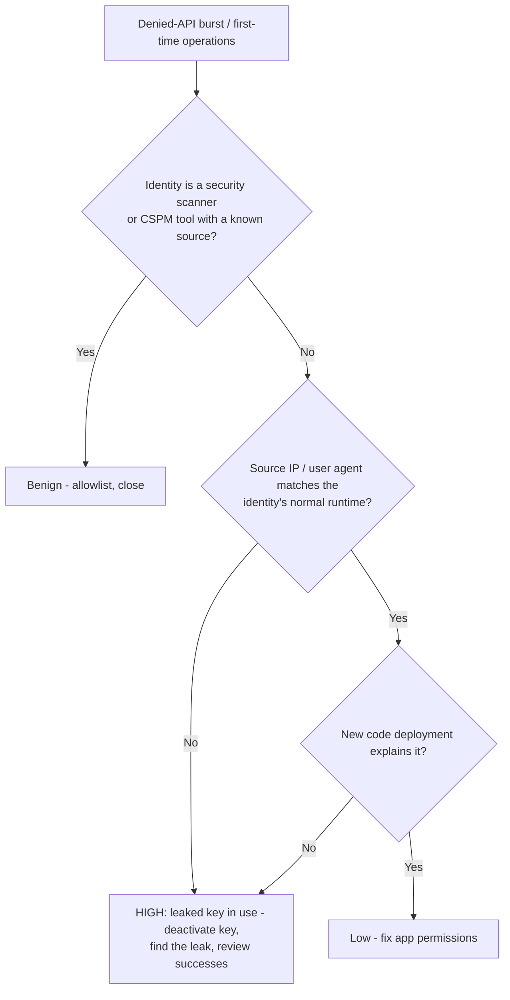

# Stolen Cloud Key Enumeration

> The first thing anyone does with a found key is ask "who am I and what can I do?" That means `GetCallerIdentity`, then a burst of List/Describe calls, many of them **AccessDenied**. Tools such as Pacu, enumerate-iam and ScoutSuite make this noisy. It is the cheapest point to catch a leaked key: **before it finds the permission that matters**.

## When this fires
- `aws_access_denied_enumeration` / `aws-access-denied-enumeration`: one identity hits AccessDenied across many distinct APIs
- `azure_authorization_failure_enumeration` / `azure-authorization-failure-enumeration`: authorization failures across many operations
- `azure-caller-first-time-operation`: a caller performs operations it has never used before

## Triage decision tree


## Investigation steps
1. The identity's recent call pattern, successes and failures:
   ```kql
   let arn = "<USER_IDENTITY_ARN>";
   AWSCloudTrail
   | where TimeGenerated > ago(2d) and UserIdentityArn == arn
   | summarize Calls = count(), Denied = countif(ErrorCode in ("AccessDenied", "UnauthorizedOperation", "Client.UnauthorizedOperation")),
       Apis = dcount(EventName), Sample = make_set(EventName, 40) by SourceIpAddress, UserAgent, bin(TimeGenerated, 1h)
   | order by TimeGenerated asc
   ```
2. Look at what **succeeded**: it shows what the attacker now knows and can do (S3 listing, IAM reads, secrets).
3. Find the key's origin: `UserIdentityAccessKeyId`, when it was created, the owner, and where it is supposed to be used. Search public repositories and CI logs for it ([source code exposure](../saas/source-code-secret-exposure.md)).
4. Check for follow-on actions: new users, keys or roles, or compute launches ([cryptojacking](cryptojacking-compute-abuse.md), [LLMjacking](../ai/llmjacking-ai-resource-abuse.md)).

## True vs false positive

| Points to attack | Points to benign |
|---|---|
| `GetCallerIdentity` from a VPS, then 50 distinct APIs denied | Prowler / ScoutSuite run from the security account |
| User agent of an enumeration tool or a raw SDK from a new IP | App deployed with missing permissions (same IP as the app) |
| Key belongs to a CI user that never calls IAM | Developer exploring a new service in a sandbox |

## Containment & response
- Deactivate the key; review and revert anything created by successful calls.
- Find and remove the leak; rotate any other secrets in the same location.
- Prevent: no long-lived user keys (SSO / roles), alerts on `GetCallerIdentity` from new IPs for service users, SCPs, and permission boundaries.

## Escalation criteria
Any successful sensitive action after the enumeration, or keys with admin-level permissions → IR.

## Evidence to collect
CloudTrail for the key, key metadata and owner, leak location, list of successful calls.
