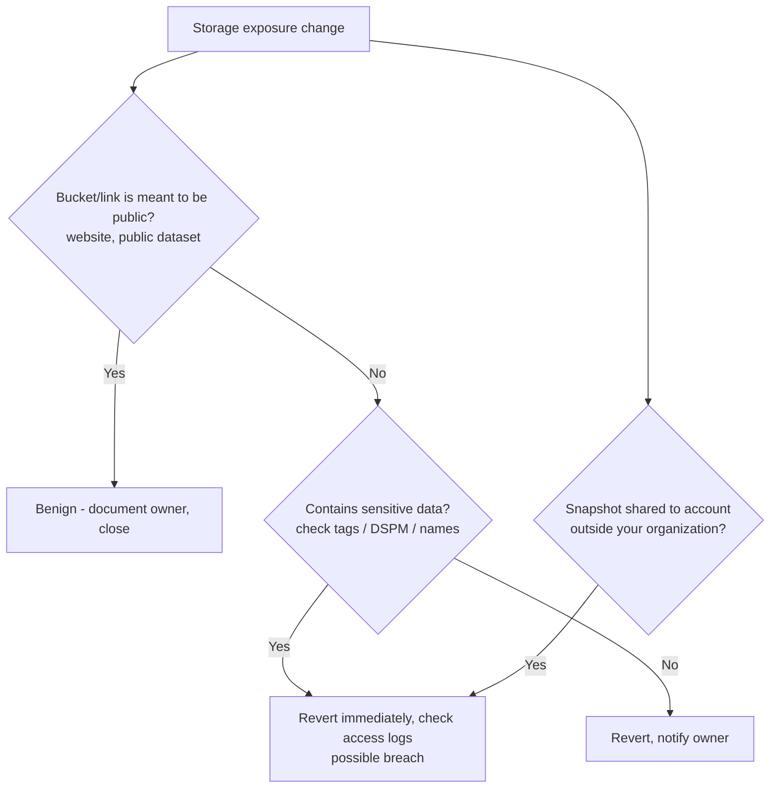

# Cloud Storage Exposure and Snapshot Sharing

> Buckets made public and snapshots shared to foreign accounts are how cloud data leaves without a single network alert.

## Triage decision tree

## Investigation steps
1. What exactly changed: public access block removed, policy with `"Principal": "*"`, ACL `AllUsers`, `allUsers` IAM member, snapshot `createVolumePermission` with an external account ID.
2. Who did it, from where, and what else did they do?
3. Was data accessed after exposure? S3 server access logs / CloudTrail data events / GCS data access logs for anonymous or foreign-account reads.
4. Data classification of the resource.

## Containment & response
- Re-enable Block Public Access / remove public members / revoke the snapshot share.
- Enable account-level Block Public Access and org policies (`storage.publicAccessPrevention`).
- If data was accessed: engage privacy/legal for breach assessment.

## Escalation criteria
Sensitive data + external access, or snapshot shared to unknown account → IR + privacy.

## Evidence to collect
Policy before/after, access logs, external account IDs, data classification.
