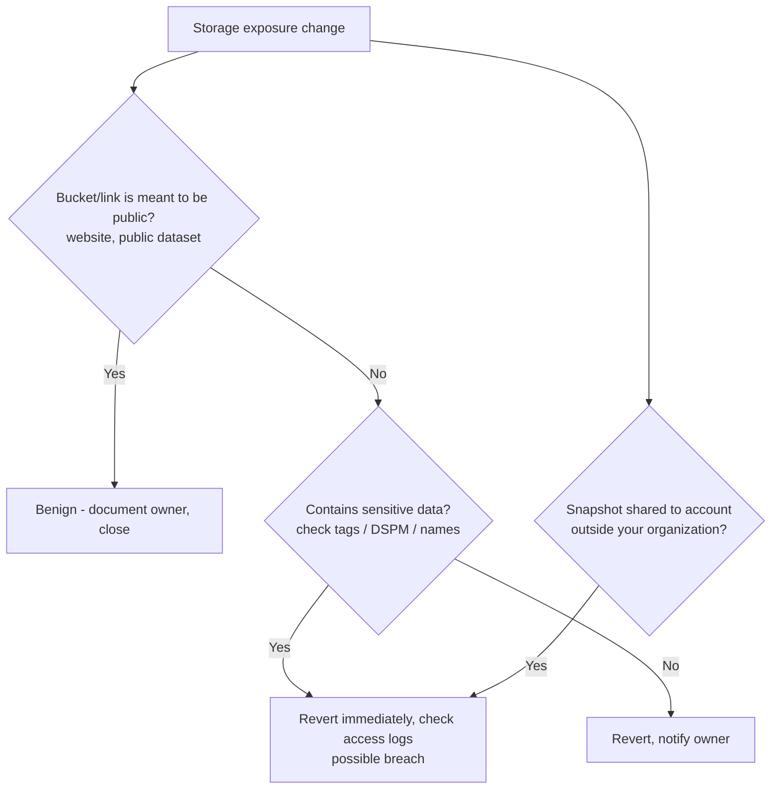

# Cloud Storage Exposure and Snapshot Sharing

> Buckets made public and snapshots shared to foreign accounts are how cloud data leaves without a single network alert.

## When this fires
- `aws_s3_public_access_block_removed` (SecOps): S3 Block Public Access removed at bucket or account level - the step that precedes most S3 data exposures
- `aws_s3_bucket_policy_changed` (SecOps): S3 bucket policy or ACL modified
- `aws_snapshot_or_ami_shared` (SecOps): EBS/RDS snapshot or AMI attributes modified - the way attackers share disks with their own account to exfiltrate data
- `gcp_bucket_iam_changed` (SecOps): Cloud Storage bucket IAM permissions changed - review for allUsers / allAuthenticatedUsers
- `m365_anonymous_link_created` (SecOps): An anonymous ("Anyone") sharing link was created
- `m365_mass_file_download` (SecOps): One user downloaded 300+ files from SharePoint / OneDrive within 30 minutes
- `aws-s3-public-or-policy-opened` (Sentinel): Public access block deleted, or a bucket policy / ACL granting access to everyone (Principal '*' or AllUsers)
- `azure-storage-public-access-enabled` (Sentinel): allowBlobPublicAccess enabled on a storage account, a container set to Blob/Container public access, or network rules opened to all networks
- `azure-storage-anonymous-read` (Sentinel): Successful anonymous (unauthenticated) blob reads, aggregated by account and client IP
- `gcp-bucket-made-public` (Sentinel): Cloud Storage IAM changed to include allUsers or allAuthenticatedUsers - a public bucket

## Triage decision tree

## Investigation steps
1. What exactly changed: public access block removed, policy with `"Principal": "*"`, ACL `AllUsers`, `allUsers` IAM member, snapshot `createVolumePermission` with an external account ID.
2. Who did it, from where, and what else did they do?
3. Was data accessed after exposure? S3 server access logs / CloudTrail data events / GCS data access logs for anonymous or foreign-account reads.
4. Data classification of the resource.

## True vs false positive

| Points to attack | Points to benign |
|---|---|
| Bucket holds internal or regulated data | Bucket intentionally hosts a public website or assets |
| Anonymous reads from many IPs right after the change | Public read only on a CDN origin with no sensitive objects |
| Block Public Access removed at account level | Exception approved and documented by the data owner |

## Containment & response
- Re-enable Block Public Access / remove public members / revoke the snapshot share.
- Enable account-level Block Public Access and org policies (`storage.publicAccessPrevention`).
- If data was accessed: engage privacy/legal for breach assessment.

## Escalation criteria
Sensitive data + external access, or snapshot shared to unknown account → IR + privacy.

## Evidence to collect
Policy before/after, access logs, external account IDs, data classification.
