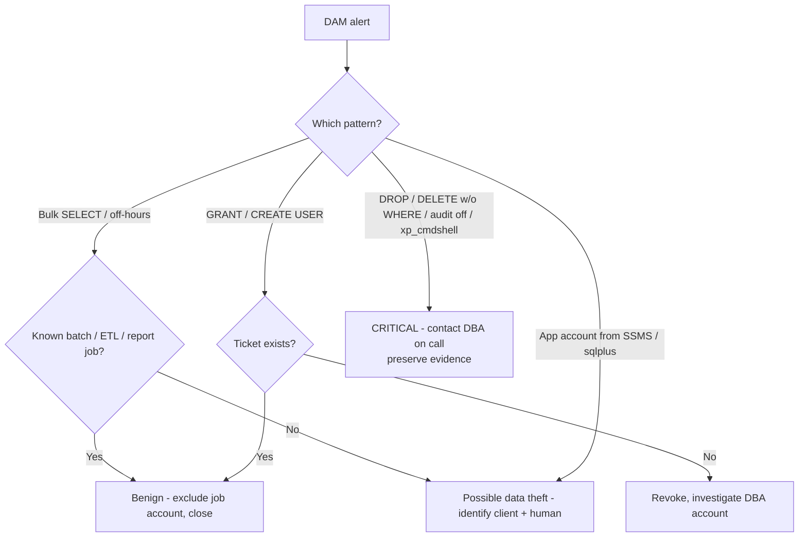

# Database Abuse (Guardium DAM)

> The database is usually the attacker's final objective. DAM sees the SQL that network tools never will.

## When this fires
- `dam_bulk_data_access_single_user` (SecOps): A single database user issues an unusually high number of SELECT statements against monitored objects within 15 minutes, as reported by IBM Guardium DAM
- `dam_off_hours_sensitive_access` (SecOps): 50+ SELECTs by one DB user between 00:00 and 05:00 UTC
- `dam_service_account_interactive_tool` (SecOps): An application/service DB account used from an interactive client tool (SSMS, sqlplus, DBeaver, Toad ...) - stolen application credentials used by a human
- `dam_privilege_grant` (SecOps): GRANT of powerful database roles (DBA, sysadmin, db_owner, ALL PRIVILEGES, SUPERUSER)
- `dam_destructive_ddl` (SecOps): DROP or TRUNCATE executed against a monitored database - data destruction (or sabotage) of production tables
- `dam_delete_without_where` (SecOps): DELETE FROM a table with no WHERE clause - wipes the whole table
- `dam_os_command_execution` (SecOps): Database features that execute OS commands or write files (xp_cmdshell, sp_OACreate, COPY 
- `dam_credential_table_access` (SecOps): Queries against password-hash tables (sys.user$, dba_users, sys.sql_logins, mysql.user, pg_shadow, pg_authid)
- `dam_audit_disabled` (SecOps): Native database auditing disabled (audit_trail=none, NOAUDIT, server audit off/dropped, general_log off)
- `azure-sql-bulk-data-read` (Sentinel): A single statement or principal returned 100,000+ rows within an hour (affected_rows in SQL auditing)
- `azure-sql-destructive-or-privilege-statements` (Sentinel): DROP/TRUNCATE TABLE, DELETE without WHERE, GRANT/ALTER ROLE to sysadmin/db_owner, or xp_cmdshell in Azure SQL audit logs
- `azure-sql-access-outside-hours` (Sentinel): Successful logins to Azure SQL from interactive tools (SSMS, Azure Data Studio, sqlcmd, DBeaver...) between 20:00 and 06:00 UTC
- `azure-sql-failed-logins` (Sentinel): 20+ failed authentication attempts against an Azure SQL database from one client IP in an hour (SQL auditing)

## Triage decision tree

## Investigation steps
1. From Guardium: DB user, OS user, client IP/hostname, source program, full SQL, object names, rows returned.
2. Map the client IP to a host and logged-on human (Windows logon events / VPN logs).
3. Data sensitivity of the objects (PII, cardholder, credentials) - check Guardium classification.
4. Pattern over time: is this a new behaviour for this DB user? Compare 30-day baseline in Guardium reports.
5. For `xp_cmdshell` / `COPY FROM PROGRAM`: pivot to the DB server process telemetry (`win_sqlserver_spawns_shell`).

## True vs false positive

| Points to attack | Points to benign |
|---|---|
| Application service account used from SSMS / DBeaver on a user workstation | DBA maintenance from the jump host during a change window |
| SELECT * on card or PII tables returning millions of rows | Scheduled ETL or reporting job with a stable pattern |
| DROP / TRUNCATE / DELETE without WHERE outside a release | Release script executed by the deployment account |

## Containment & response
- Lock or change the password of the DB account; kill active sessions.
- For app accounts used interactively: rotate the credential in the vault and restrict it to the app server IPs.
- Restore audit settings; restore dropped/deleted data from backup.
- Use Guardium S-GATE / blocking policy for repeated abuse.

## Escalation criteria
Sensitive data accessed by an unexplained human, destructive SQL in production, audit disablement, or OS command execution → IR + data owner.

## Evidence to collect
Guardium session report (full SQL), client host details, row counts, data classification.
