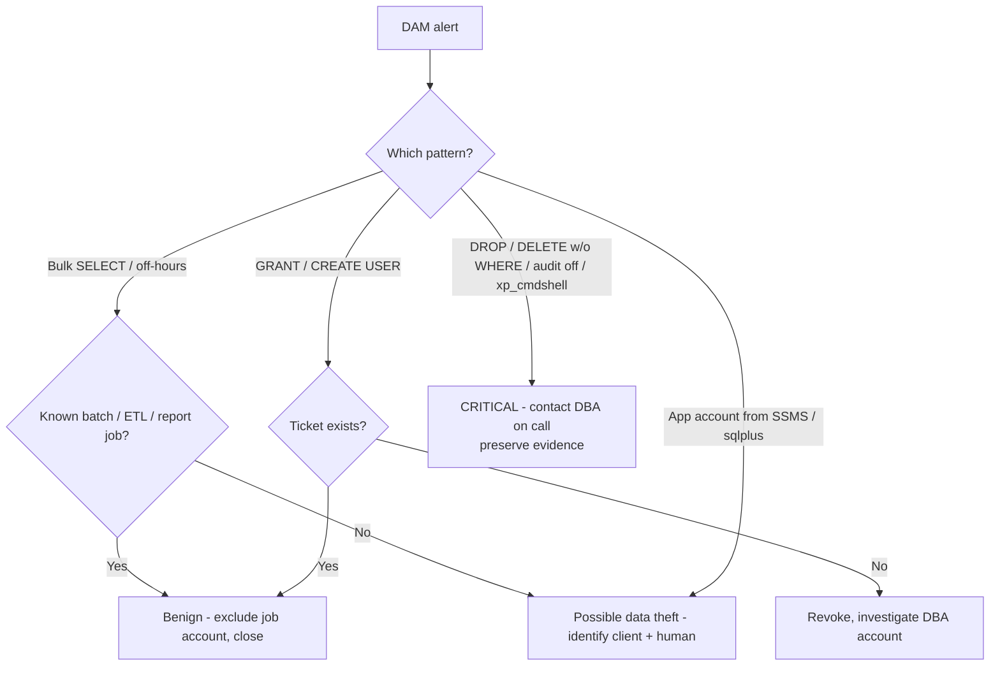

# Database Abuse (Guardium DAM)

> The database is usually the attacker's final objective. DAM sees the SQL that network tools never will.

## Triage decision tree

## Investigation steps
1. From Guardium: DB user, OS user, client IP/hostname, source program, full SQL, object names, rows returned.
2. Map the client IP to a host and logged-on human (Windows logon events / VPN logs).
3. Data sensitivity of the objects (PII, cardholder, credentials) - check Guardium classification.
4. Pattern over time: is this a new behaviour for this DB user? Compare 30-day baseline in Guardium reports.
5. For `xp_cmdshell` / `COPY FROM PROGRAM`: pivot to the DB server process telemetry (`win_sqlserver_spawns_shell`).

## Containment & response
- Lock or change the password of the DB account; kill active sessions.
- For app accounts used interactively: rotate the credential in the vault and restrict it to the app server IPs.
- Restore audit settings; restore dropped/deleted data from backup.
- Use Guardium S-GATE / blocking policy for repeated abuse.

## Escalation criteria
Sensitive data accessed by an unexplained human, destructive SQL in production, audit disablement, or OS command execution → IR + data owner.

## Evidence to collect
Guardium session report (full SQL), client host details, row counts, data classification.
