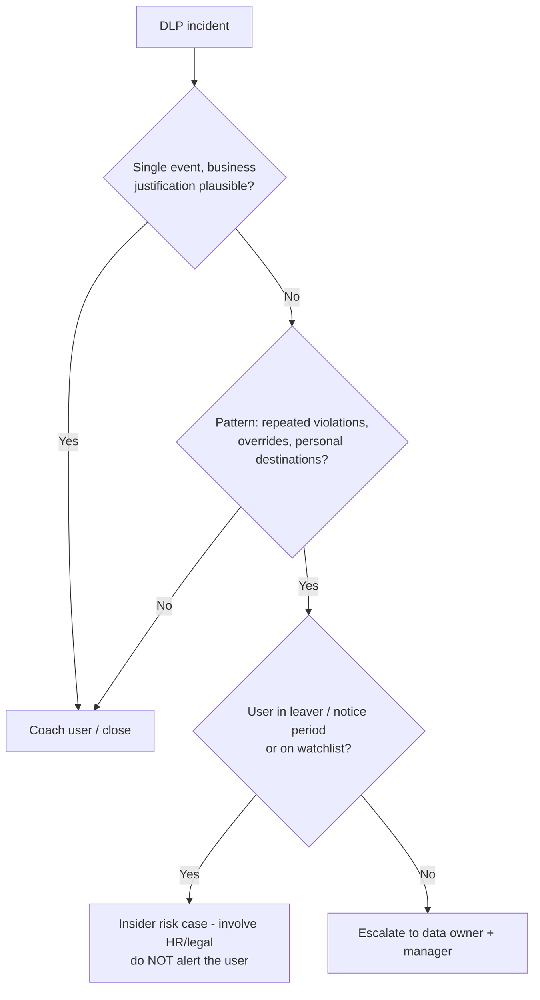

# DLP Incident / Insider Exfiltration

> DLP incidents are mostly mistakes - but a pattern of them, especially before a resignation date, is how insider theft looks.

## Triage decision tree

## Investigation steps
1. What data (classification, volume, file names), which channel (email, web upload, USB, print), destination.
2. User history: prior DLP incidents, overrides, and recent HR status (resignation, PIP) via the insider-risk process.
3. Correlate with other telemetry: mass file downloads (`m365_mass_file_download`), archive creation, cloud uploads.
4. Account compromise check: was it really the user? (Login locations, device.)

## Containment & response
- Block the channel (USB policy, cloud app sanctioning) for the user if theft is suspected.
- Request deletion / recovery of data from personal accounts via legal.
- Handle insider cases discreetly through HR/legal - preserve chain of custody.

## Escalation criteria
Regulated data (PCI, PII, PHI) leaving the organization, or insider pattern → privacy officer / HR / legal.

## Evidence to collect
DLP incident records, file samples (from DLP evidence store), user timeline, HR context (via legal).
