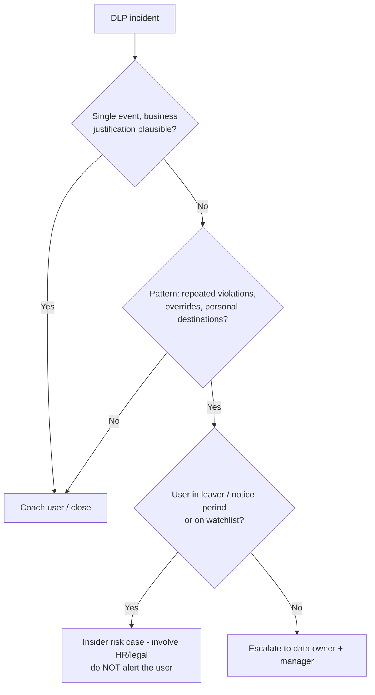

# DLP Incident / Insider Exfiltration

> DLP incidents are mostly mistakes - but a pattern of them, especially before a resignation date, is how insider theft looks.

## When this fires
- `dlp_high_severity_incident` (SecOps): DLP incident with high or critical severity
- `dlp_repeated_violations_user` (SecOps): Ten or more DLP violations by one user within 24 hours - possible insider exfiltration
- `dlp_personal_cloud_upload` (SecOps): DLP flagged sensitive content uploaded to a personal cloud storage service
- `dlp_removable_media_copy` (SecOps): Sensitive data copied to USB / removable media
- `dlp_email_to_personal_domain` (SecOps): DLP-flagged email sent to a free-mail domain (gmail, yahoo, outlook.com, proton ...) - employees mailing data to themselves
- `dlp_user_override_abuse` (SecOps): A user overrode DLP blocks (business justification) 5+ times within 24 hours
- `dlp_pci_data_outbound` (SecOps): DLP detected payment card (PAN / PCI) data leaving the organization
- `dlp-policy-match` (Sentinel): Purview DLP rule matches (DlpRuleMatch) across Exchange, SharePoint, OneDrive and Teams, aggregated per user
- `upload-to-unsanctioned-app` (Sentinel): File uploads to personal cloud storage and file-transfer apps seen through Defender for Cloud Apps (Dropbox, Google Drive, Box, WeTransfer, Mega...)
- `usb-file-copy-burst` (Sentinel): 100+ files written to a removable drive within 30 minutes by one user

## Triage decision tree

## Investigation steps
1. What data (classification, volume, file names), which channel (email, web upload, USB, print), destination.
2. User history: prior DLP incidents, overrides, and recent HR status (resignation, PIP) via the insider-risk process.
3. Correlate with other telemetry: mass file downloads (`m365_mass_file_download`), archive creation, cloud uploads.
4. Account compromise check: was it really the user? (Login locations, device.)

## True vs false positive

| Points to attack | Points to benign |
|---|---|
| Repeated matches for the same user, with overrides justified as 'personal' | One-off match on a false-positive pattern (test card numbers) |
| Destination is the user's personal email or cloud storage | Approved partner domain with a data-sharing agreement |
| Spike after resignation or a performance process | Business process change that triggers a new policy |

## Containment & response
- Block the channel (USB policy, cloud app sanctioning) for the user if theft is suspected.
- Request deletion / recovery of data from personal accounts via legal.
- Handle insider cases discreetly through HR/legal - preserve chain of custody.

## Escalation criteria
Regulated data (PCI, PII, PHI) leaving the organization, or insider pattern → privacy officer / HR / legal.

## Evidence to collect
DLP incident records, file samples (from DLP evidence store), user timeline, HR context (via legal).
