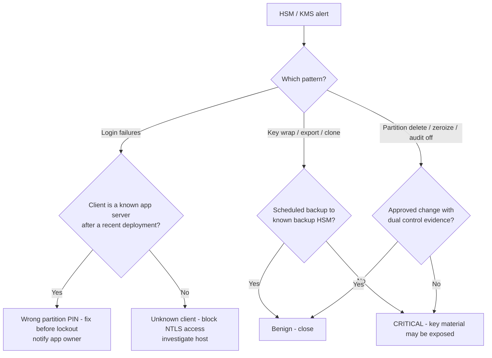

# HSM / Key Management Attack (Thales Luna, CipherTrust)

> HSM incidents are rare but catastrophic: stolen signing / TLS / payment keys enable undetectable impersonation, and destroyed keys mean permanently unreadable data.

## Triage decision tree

## Investigation steps
1. Identify the client (NTLS client cert / IP), role used (Security Officer, Crypto Officer, Crypto User), partition and key labels/handles.
2. Check the HSM change calendar and **M-of-N / dual-control** records - legitimate destructive operations require them.
3. For key export: which keys, wrapping key used, destination. Was the key marked extractable? (`CKA_EXTRACTABLE`).
4. Review the client host for compromise (EDR alerts, logins).
5. Confirm audit logs are still flowing - attackers disable HSM audit first.

## Containment & response
- Revoke the client's NTLS registration / partition assignment; change partition credentials.
- If private keys may be exposed: revoke and re-issue the affected certificates, rotate data keys, notify PKI and payment teams.
- If keys were destroyed: restore from backup HSM per key recovery procedure.
- Restore audit configuration and syslog forwarding.

## Escalation criteria
Any unexplained export, deletion, zeroize or audit change → IR + crypto custodian + CISO.

## Evidence to collect
HSM audit log (signed audit records), client details, key handles/labels, change and dual-control records.
