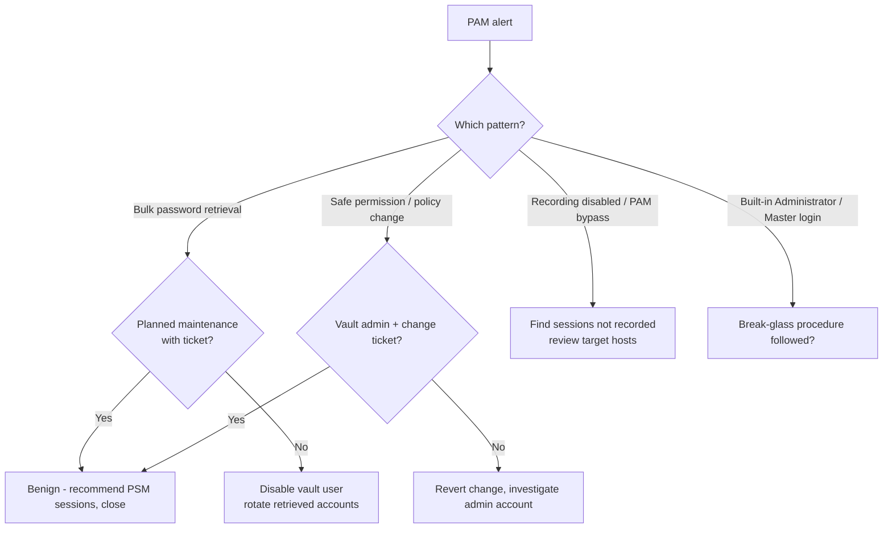

# PAM Vault Abuse (CyberArk / ARCON)

> The PAM vault holds the keys to the kingdom. Mass password retrieval, permission changes or recording being disabled are top-priority alerts.

## When this fires
- `cyberark_bulk_password_retrieval` (SecOps): One user retrieved passwords for 10+ different privileged accounts within an hour (Retrieve Password, event 295) - vault harvesting
- `cyberark_vault_login_failures` (SecOps): Five or more failed CyberArk Vault / PVWA logins from one source within 15 minutes
- `cyberark_builtin_admin_login` (SecOps): Login with CyberArk built-in super-users (Administrator, Master) - break-glass accounts
- `cyberark_safe_permission_change` (SecOps): Safe members / owners added or updated - grants access to privileged credentials
- `cyberark_master_policy_change` (SecOps): Master policy or platform settings changed - can disable rotation, dual control or session recording
- `cyberark_psm_recording_disabled` (SecOps): PSM session recording disabled or failing - privileged sessions become unaudited
- `arcon_bulk_password_view` (SecOps): One user viewed / revealed passwords of 10+ privileged accounts within an hour
- `arcon_policy_or_role_change` (SecOps): ARCON user/group/role/policy privilege change
- `pam_bypass_direct_admin_login` (SecOps): Interactive / RDP login with an admin-named account (adm-, -adm, _admin) that did NOT come from a PAM jump host - PAM bypass
- `pam-vault-bulk-password-retrieval` (Sentinel): One vault user retrieved 20 or more different privileged credentials within an hour (CyberArk 'Retrieve password' and equivalent PAM events received as CEF)
- `pam-vault-policy-or-safe-permission-change` (Sentinel): Changes to the PAM vault's master policy, safe membership or permissions, or session recording settings (CyberArk and equivalent PAM events received as CEF)

## Triage decision tree

## Investigation steps
1. Vault user, source IP, authentication method (LDAP, RADIUS/MFA, PKI) and the accounts/safes involved.
2. List every privileged account retrieved or session opened in the window, and where those credentials were used afterwards (logins on target systems).
3. Was the vault user's own identity compromised? (AD sign-ins, MFA anomalies.)
4. For PAM bypass: who logged in directly to the server with an admin account and from which host?

## True vs false positive

| Points to attack | Points to benign |
|---|---|
| Bulk password retrieval for many accounts by one user | Password reconciliation job by the CPM component |
| Built-in Administrator / Master user logged in outside a break-glass event | Vendor-assisted upgrade with an open ticket |
| Session recording disabled or Safe permissions widened | Planned Safe restructuring approved by PAM owners |

## Containment & response
- Suspend the vault user; trigger immediate CPM rotation of every retrieved account.
- Revert safe/policy changes; re-enable session recording.
- Restrict direct admin logons via firewall/GPO so only PSM/jump hosts can reach admin ports.

## Escalation criteria
Unexplained bulk retrieval, unauthorized policy/permission change, or use of built-in super-users outside break-glass → IR.

## Evidence to collect
Vault audit logs, list of retrieved accounts, PSM recordings, target-system logins.
