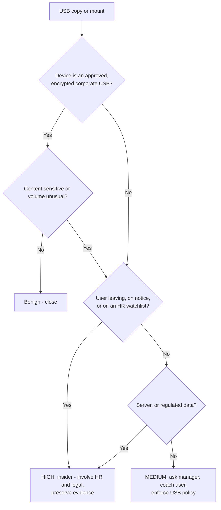

# USB / Removable Media Exfiltration

> Copying files to a USB drive leaves no network trace, so endpoint telemetry and DLP are the only witnesses. Departing employees are the classic case. A USB drive mounted on a **server** is unusual in any context and should always be checked.

## When this fires
- `dlp_removable_media_copy`: Endpoint DLP detected sensitive content copied to removable media
- `usb-file-copy-burst`: many files written to a removable drive by one user in a short window
- `usb-mass-storage-on-server`: a USB mass-storage device mounted on a server

## Triage decision tree


## Investigation steps
1. Mount events and files written:
   ```kql
   let host = "<DEVICE_NAME>";
   let mounts = DeviceEvents
   | where TimeGenerated > ago(7d) and DeviceName startswith host and ActionType == "UsbDriveMounted"
   | extend Drive = tostring(parse_json(AdditionalFields).DriveLetter), Product = tostring(parse_json(AdditionalFields).ProductName),
            Serial = tostring(parse_json(AdditionalFields).SerialNumber)
   | project MountTime = TimeGenerated, DeviceId, Drive, Product, Serial;
   DeviceFileEvents
   | where TimeGenerated > ago(7d) and DeviceName startswith host and ActionType in ("FileCreated", "FileModified")
   | join kind=inner mounts on DeviceId
   | where TimeGenerated between (MountTime .. (MountTime + 8h)) and FolderPath startswith Drive
   | summarize Files = count(), Sample = make_set(FileName, 30), Bytes = sum(FileSize) by Drive, Product, Serial, InitiatingProcessAccountName
   ```
2. Classify the content: DLP matches, sensitivity labels and source folders (HR, finance, engineering).
3. Check context: resignation or notice, recent mass downloads from SharePoint ([mass download](../saas/mass-download-saas.md)), and personal-cloud uploads.
4. Record the device serial number. It helps if the device is later recovered.

## True vs false positive

| Points to exfiltration | Points to benign |
|---|---|
| Thousands of files, including confidential labels, after a resignation | Approved encrypted drive used for a site visit |
| Personal USB on a file server | Firmware upload by an engineer with a ticket |
| Copies at night or on the last working days | Single presentation copied for a conference |

## Containment & response
- Insider: follow the HR / legal process. Do not confront the user before evidence is preserved.
- Enforce device control: block unapproved removable storage (Defender device control / Intune), allow encrypted corporate devices only, and use read-only mode where possible.
- Block USB mass storage on servers entirely.

## Escalation criteria
Regulated or crown-jewel data, server context, or a deliberate insider pattern → insider-risk team / HR / legal, and IR for regulated data.

## Evidence to collect
Mount and file events, DLP matches, device serial, user context (HR), and the timeline.
