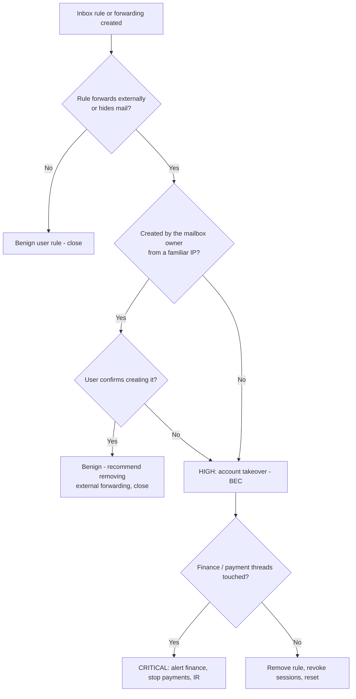

# BEC - Malicious Inbox Rules and Forwarding

> After taking over a mailbox, business-email-compromise actors create rules that **hide replies** (move to RSS Feeds / Archive, mark as read, delete) and **forward mail** to an outside address. They then sit in the payment conversation and change the bank details.

## When this fires
- `o365_mailbox_forwarding_set` / `mailbox-forwarding-smtp-set`: `Set-Mailbox` with `ForwardingSmtpAddress` / `ForwardingAddress` to an external domain
- `m365_inbox_or_transport_rule` / `m365-inbox-forwarding-rule`: `New-InboxRule` / `Set-InboxRule` that forwards, redirects, deletes or moves mail to obscure folders, or a new transport rule

## Triage decision tree


## Investigation steps
1. Show the rule parameters and where it was created from:
   ```kql
   let upn = "<USER_UPN>";
   OfficeActivity
   | where TimeGenerated > ago(14d) and UserId =~ upn
   | where Operation in ("New-InboxRule", "Set-InboxRule", "UpdateInboxRules", "Set-Mailbox", "New-TransportRule")
   | project TimeGenerated, Operation, ClientIP, Parameters
   ```
   Red-flag parameters: `ForwardTo`, `RedirectTo`, `ForwardingSmtpAddress`, `DeleteMessage`, `MoveToFolder` = RSS Feeds / Conversation History / Archive, `MarkAsRead`, and keywords such as *invoice*, *payment*, *wire* or *bank*.
2. Correlate `ClientIP` with the user's sign-ins. A rule created from a new IP or a hosting ASN right after a successful sign-in means takeover.
3. Review what was read and sent from the attacker window (`MailItemsAccessed`, `Send`), especially replies to external payment threads.
4. Check other mailboxes for rules with the same name or the same forwarding address. BEC crews reuse them.
5. SecOps pivot:
   ```
   metadata.product_event_type = "New-InboxRule" AND principal.user.email_addresses = "<USER_UPN>"
   ```

## True vs false positive

| Points to BEC | Points to benign |
|---|---|
| Rule named `.`, `..`, `aaa` or a single character; moves to RSS Feeds | Clearly named user rule ("Newsletters to folder") |
| Forwarding to a free-mail address | Forwarding to an approved partner via a ticket |
| Created from a new country or VPS minutes after a phish click | Created from the user's usual device and IP |

## Containment & response
- Remove the rules and forwarding, revoke sessions, reset the password and review MFA methods.
- If payment threads were touched: tell finance **out-of-band** to freeze or verify changed bank details, and contact the external partner.
- Block automatic external forwarding with the outbound spam policy (set it to *Off*, with exceptions only).
- Search all mailboxes for the same forwarding address or rule pattern.

## Escalation criteria
Any confirmed takeover involving finance or executives, or a fraudulent payment request → IR (and legal / finance).

## Evidence to collect
Rule parameters and creation events, sign-in records, messages read and sent in the attacker window, and the forwarding address.
