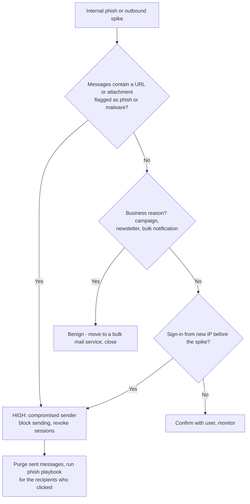

# Compromised Mailbox Sending Phish / Mass Outbound

> A trusted internal mailbox is sending phishing internally (lateral phishing), or is sending unusual volumes outbound. Recipients trust the sender, so click rates are far higher than for external phish. **Stop the sender first, then clean up.**

## When this fires
- `o365_mass_outbound_email_sender` / `mass-outbound-email-from-user`: a user sends far more external mail, or to far more recipients, than their baseline
- `internal-phish-from-compromised-mailbox`: Defender flagged phish whose sender is an internal mailbox

## Triage decision tree


## Investigation steps
1. Confirm the volume and recipients:
   ```kql
   let upn = "<SENDER_UPN>";
   EmailEvents
   | where TimeGenerated > ago(2d) and SenderFromAddress =~ upn
   | summarize Messages = count(), Recipients = dcount(RecipientEmailAddress), Subjects = make_set(Subject, 10),
       Threats = make_set(ThreatTypes, 10) by EmailDirection, bin(TimeGenerated, 1h)
   | order by TimeGenerated asc
   ```
2. Find how the mailbox was taken over: risky sign-ins, AiTM / token alerts, inbox rules created to hide bounces and replies ([BEC rules](bec-inbox-rules-forwarding.md)).
3. List internal recipients who **clicked** links from these messages (UrlClickEvents by NetworkMessageId), and treat them as the next ring of potential compromises.
4. Check whether Exchange Online restricted the sender (`Restricted entities` / outbound spam alert).

## True vs false positive

| Points to compromise | Points to benign |
|---|---|
| Generic "shared document" / "invoice" lure sent to hundreds of colleagues | Planned HR or IT announcement |
| Sent items deleted, or a rule hides NDRs | Mail merge from the user's own client during business hours |
| Preceded by a risky sign-in | Volume matches a known monthly cycle |

## Containment & response
- Block sign-in or revoke sessions, reset the password and review MFA; remove inbox rules and app consents.
- Purge the messages from all recipient mailboxes and block the URLs and domains.
- Contact clickers and run [phish delivered / clicked](phish-delivered-or-clicked.md) for them.
- If external recipients were targeted, notify affected partners. Your domain's reputation may also need delisting.

## Escalation criteria
More than one compromised internal mailbox, executives or finance as sender, or external partners phished → IR.

## Evidence to collect
Message trace for the window, sender sign-ins, rules, recipient and clicker lists, and purge results.
