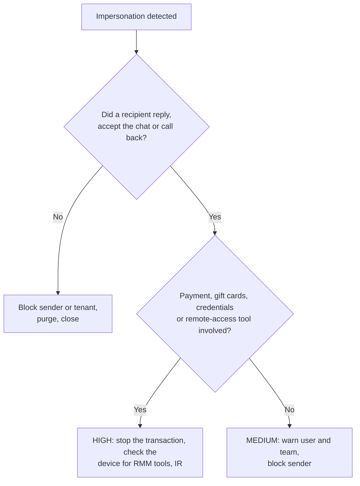

# Executive / Brand Impersonation (Email and Teams)

> No malware, no link: just a message that *looks like* the CEO, the IT helpdesk or your own domain, asking for gift cards, a wire transfer or an MFA approval. External Teams chats from "IT Support" now deliver malware loaders and vishing. **Did anyone act on it?**

## When this fires
- `executive-display-name-impersonation`: an external sender uses the display name of someone on the VIP watchlist
- `spoofing-dmarc-fail-delivered`: a message claiming to be from your own domain failed DMARC but was delivered
- `m365_teams_external_impersonation` / `teams-external-chat-impersonation`: an external tenant whose display name contains "help desk", "IT support", "security" or similar started a 1:1 chat

## Triage decision tree


## Investigation steps
1. Gather all messages from the impersonating sender, or using the display name:
   ```kql
   let vipName = "<EXECUTIVE DISPLAY NAME>";
   EmailEvents
   | where TimeGenerated > ago(7d) and EmailDirection == "Inbound"
   | where SenderDisplayName has vipName
   | project TimeGenerated, SenderDisplayName, SenderFromAddress, SenderMailFromDomain, RecipientEmailAddress, Subject, DeliveryAction, AuthenticationDetails
   ```
2. Check authentication results (`AuthenticationDetails`: SPF, DKIM, DMARC, CompAuth). A DMARC fail for your own domain that was delivered points to a policy gap (`p=none`) or a transport rule bypass.
3. For Teams: find which users accepted the external chat, and whether a remote-access tool (Quick Assist, AnyDesk, TeamViewer) was then launched on their device.
4. Ask recipients directly whether they replied, paid, or shared codes.

## True vs false positive

| Points to impersonation | Points to benign |
|---|---|
| Free-mail or lookalike domain using the CEO's display name | Executive's genuine personal address (verify by phone) |
| Urgent request for payment, gift cards or secrecy | Vendor with a similar name and a long, clean history |
| External Teams tenant created recently with "IT" in its name | Approved managed-service partner tenant |

## Containment & response
- Block the sender or domain (Tenant Allow/Block List) or the external Teams domain; purge messages.
- If a payment was requested or made: contact finance and the bank immediately.
- If remote access was granted: isolate the device and run [remote access tool](../endpoint/remote-access-tunneling.md).
- Harden: DMARC `p=reject`, impersonation protection for VIPs in anti-phishing policy, and restrict Teams external access to allowed domains.

## Escalation criteria
Any financial loss or attempt in progress, credential disclosure, or a remote-access session → IR.

## Evidence to collect
Messages or chat transcripts with headers, authentication results, recipient responses, and any payment or remote-session details.
