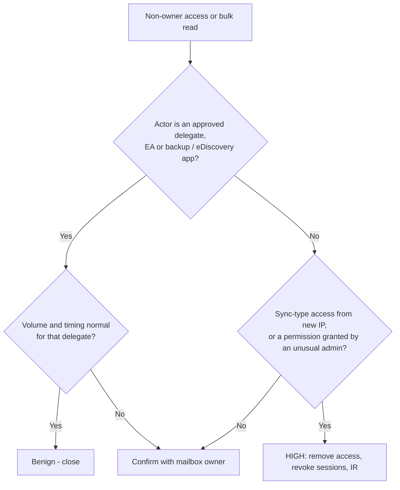

# Mailbox Accessed by Non-Owner / Bulk Mail Read

> Someone other than the owner, whether a delegate, an admin or an application, read large amounts of a mailbox, or was given FullAccess to it. The aim is usually espionage, BEC reconnaissance or data theft, and **executive mailboxes are the prize**.

## When this fires
- `o365_mailitemsaccessed_bulk` / `mailitemsaccessed-bulk`: a very high count of `MailItemsAccessed` (Sync or Bind) for one mailbox or one actor in a short window
- `m365_mailbox_permission_granted` / `mailbox-accessed-by-non-owner`: `Add-MailboxPermission` (FullAccess), `Add-MailboxFolderPermission`, or non-owner logons to a mailbox

## Triage decision tree


## Investigation steps
1. Who accessed which mailbox, how much, and from where:
   ```kql
   let mbx = "<MAILBOX_UPN>";
   OfficeActivity
   | where TimeGenerated > ago(7d) and OfficeWorkload == "Exchange"
   | where MailboxOwnerUPN =~ mbx and Operation in ("MailItemsAccessed", "Add-MailboxPermission", "Add-MailboxFolderPermission")
   | summarize Events = count(), Ops = make_set(Operation), IPs = make_set(ClientIP, 20) by UserId, Logon_Type = tostring(column_ifexists("Logon_Type", ""))
   ```
2. `MailItemsAccessed` with **Sync** means a client downloaded the whole folder (Outlook desktop, or an attacker's IMAP/EWS tool). From a new IP, that is near-certain exfiltration.
3. Who granted the permission, and was that admin's session healthy? Review the admin's sign-ins and role activations.
4. For application access, find the app ID and check its permissions ([app-only grant](../identity/app-only-permission-grant.md)).
5. SecOps pivot:
   ```
   metadata.product_event_type = "MailItemsAccessed" AND target.user.email_addresses = "<MAILBOX_UPN>"
   ```

> `MailItemsAccessed` requires audit (Premium) / E5-level auditing. Without it, rely on permission changes and sign-in data.

## True vs false positive

| Points to attack | Points to benign |
|---|---|
| Sync access to an executive mailbox from a VPS IP | Executive assistant with documented delegation |
| FullAccess granted to a regular user by an unexpected admin | Litigation hold or eDiscovery export by legal |
| Access shortly after a risky sign-in of the actor | Migration or backup tool's service account |

## Containment & response
- Remove the permission or delegation, revoke the actor's sessions and reset the password.
- Identify the exact items accessed (Audit Premium search by `ClientInfoString` and `InternetMessageId`) for impact assessment and possible notification.
- Restrict who can assign mailbox permissions; alert on FullAccess grants to executive mailboxes.

## Escalation criteria
Unapproved access to executive, legal, HR or finance mailboxes, or any Sync access from unknown infrastructure → IR (privacy / legal may need to assess notification).

## Evidence to collect
MailItemsAccessed and permission audit records, the actor's sign-ins, the list of items accessed, and the granting admin's activity.
