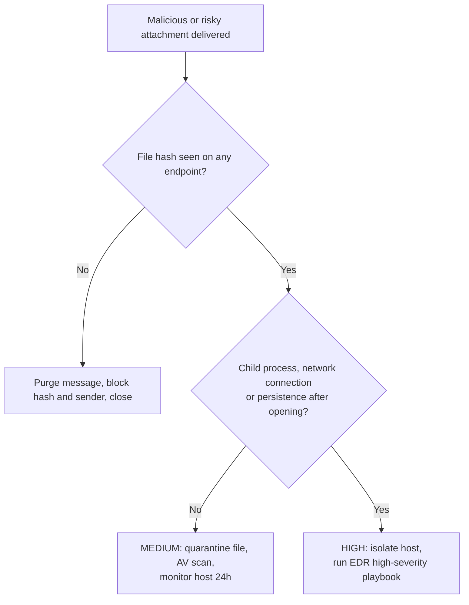

# Malware or Risky Attachment Delivered

> An attachment detected as malware reached a mailbox, or a high-risk file type (ISO, IMG, LNK, OneNote, HTML smuggling, password-protected archive) arrived from outside. The deciding question is **was it opened on an endpoint?**

## When this fires
- `o365_malware_attachment_delivered` / `malware-attachment-delivered`: Defender for Office 365 verdict Malware, delivered
- `o365_risky_attachment_type_inbound` / `risky-attachment-types-inbound`: inbound container, script or shortcut file types that are common initial-access carriers

## Triage decision tree


## Investigation steps
1. Get the attachment details and every recipient:
   ```kql
   let nmid = "<NETWORK_MESSAGE_ID>";
   EmailAttachmentInfo
   | where TimeGenerated > ago(7d)
   | where NetworkMessageId == nmid or SHA256 in ((EmailAttachmentInfo | where NetworkMessageId == nmid | project SHA256))
   | project TimeGenerated, RecipientEmailAddress, SenderFromAddress, FileName, FileType, SHA256, ThreatTypes, ThreatNames
   ```
2. Check whether the file reached a disk or was executed:
   ```kql
   let h = "<SHA256>";
   union DeviceFileEvents, DeviceProcessEvents
   | where TimeGenerated > ago(7d) and (SHA256 == h or InitiatingProcessSHA256 == h)
   | project TimeGenerated, DeviceName, ActionType, FileName, FolderPath, ProcessCommandLine, InitiatingProcessFileName
   ```
3. Containers (ISO/IMG/ZIP) hide the real payload. Look for `explorer.exe` mounting an image, then `rundll32`, `regsvr32`, `wscript`, `mshta` or `cmd` launched from the mounted drive or `%TEMP%`.
4. Detonate the file in a sandbox and pull the C2 domains and IPs to search DNS and proxy logs.
5. SecOps pivot:
   ```
   target.file.sha256 = "<SHA256>" OR principal.process.file.sha256 = "<SHA256>"
   ```

## True vs false positive

| Points to malicious | Points to benign |
|---|---|
| ISO/LNK/OneNote from an external first-time sender | Password-protected ZIP from a known partner, agreed process |
| Child processes from Office or `explorer.exe` after opening | File opened in a sandbox or preview only |
| Sandbox shows C2 or a dropped payload | Detection later reclassified by Microsoft |

## Containment & response
- Purge the message and block the hash (Defender indicators), sender and any sandbox IOCs.
- If executed: isolate the device, collect an investigation package, and follow [EDR high-severity alert](../endpoint/edr-high-severity-alert.md).
- Harden: block ISO/IMG/VHD/LNK/HTA/OneNote attachments at the transport layer, and enable ASR rules (block Office child processes, block executable content from email).

## Escalation criteria
Any execution with follow-on activity, more than one infected host, or a payload known to deliver ransomware (loader families) → IR.

## Evidence to collect
Message and attachment metadata, the file sample (in a password-protected archive), sandbox report, endpoint timeline, and IOC list.
