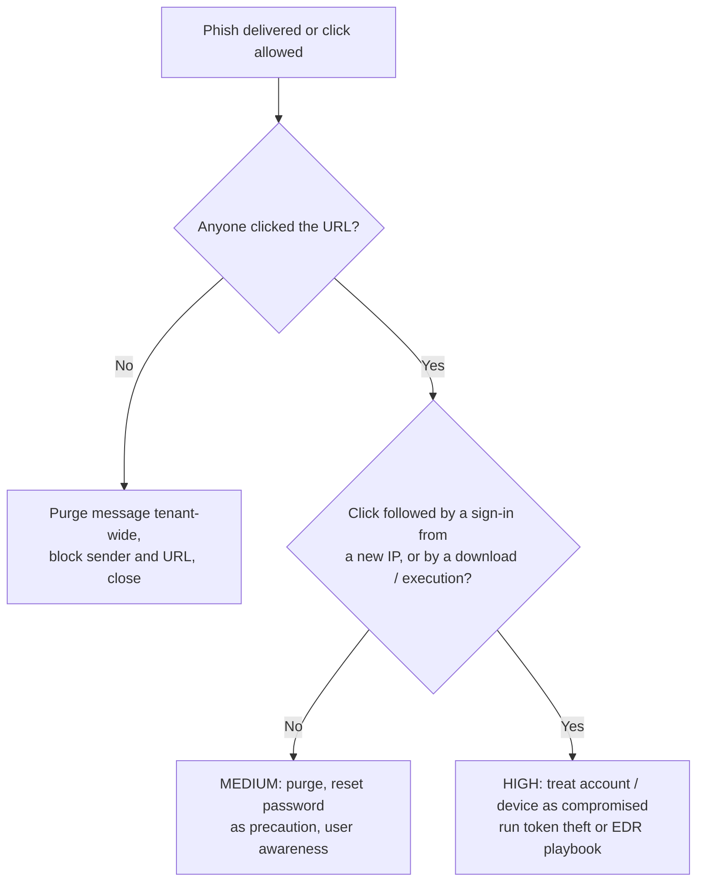

# Phishing Delivered to Inbox / URL Clicked

> A message flagged as phish reached the inbox, ZAP could not pull it back, or a user clicked through a malicious URL. The deciding question is **did anyone click and then authenticate or download?** Most of the damage happens in the next 30 minutes.

## When this fires
- `o365_phish_delivered_to_inbox` / `phish-delivered-to-inbox`: Defender for Office 365 verdict Phish, delivered to Inbox or Junk
- `malicious-url-click-allowed`: Safe Links recorded a click that was allowed or clicked through a warning
- `zap-failed-to-remove`: post-delivery ZAP failed, so the message is still in mailboxes

## Triage decision tree


## Investigation steps
1. Scope the campaign: every recipient of the same sender, subject or URL, and where each copy sits now.
   ```kql
   let nmid = "<NETWORK_MESSAGE_ID>";
   let seed = EmailEvents | where NetworkMessageId == nmid | take 1;
   EmailEvents
   | where TimeGenerated > ago(3d)
   | where SenderFromAddress in ((seed | project SenderFromAddress)) or Subject in ((seed | project Subject))
   | project TimeGenerated, RecipientEmailAddress, SenderFromAddress, Subject, DeliveryAction, DeliveryLocation, ThreatTypes, NetworkMessageId
   ```
2. Find who clicked, and whether they clicked through a warning:
   ```kql
   let urlPart = "<DOMAIN_OR_URL_FRAGMENT>";
   UrlClickEvents
   | where TimeGenerated > ago(3d) and Url has urlPart
   | project TimeGenerated, AccountUpn, Url, ActionType, IsClickedThrough, IPAddress, NetworkMessageId
   ```
3. For each clicker, look for a **successful sign-in from an unfamiliar IP within ~60 minutes** of the click (AiTM credential and session capture), and for file downloads or process launches on their device (`DeviceFileEvents`, `DeviceProcessEvents`).
4. Detonate or inspect the URL in a sandbox, and record the final landing domain and any credential form.
5. SecOps pivot:
   ```
   network.email.from = "<SENDER>" OR network.email.subject = "<SUBJECT>"
   ```

## True vs false positive

| Points to real phish | Points to benign / FP |
|---|---|
| Lookalike or newly registered domain; credential form behind redirects | Verdict later reversed; sender is a known partner with a valid DMARC pass |
| Many recipients across departments within minutes | Single internal marketing tool URL rewritten by Safe Links |
| Sign-in from hosting ASN shortly after a click | User reported it and did not click |

## Containment & response
- Purge the message from all mailboxes (Explorer / Threat Explorer → Soft delete or Move to deleted items, or `New-ComplianceSearchAction -Purge`).
- Block the sender, domain and URL in the Tenant Allow/Block List; block the domain on the proxy or DNS layer.
- Clickers who signed in: revoke sessions and reset the password ([token theft](../identity/token-theft-session-replay.md)). Clickers who downloaded: isolate the device ([EDR alert](../endpoint/edr-high-severity-alert.md)).
- Thank users who reported it, and send a short warning if the campaign is broad.

## Escalation criteria
Confirmed credential entry or session theft, malware execution, more than 10 clickers, or a VIP / finance target → IR.

## Evidence to collect
Message headers and NetworkMessageId, the URL chain and screenshots, recipient and clicker lists, sign-in records after each click, and purge results.
