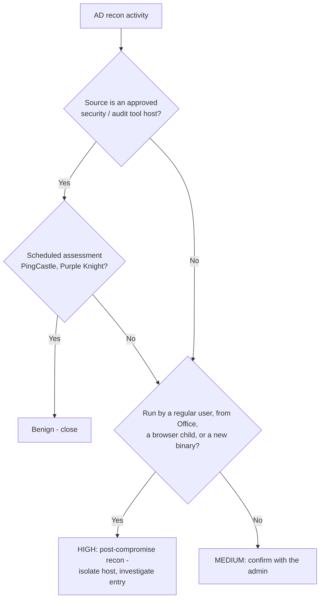

# Active Directory Reconnaissance (BloodHound / LDAP)

> Before attackers escalate, they map the domain: who is admin, which machines they log on to, which ACLs are abusable. SharpHound, AdFind and bursts of `net group` commands are **early-stage** signals. Catch them here and the intrusion is still small.

## When this fires
- `win_bloodhound_collection` / `ldap-recon-bloodhound`: SharpHound / BloodHound collectors, or a burst of LDAP queries for privileged groups, SPNs and ACLs (Defender for Identity / `IdentityQueryEvents`)
- `win_ad_recon_commands`: `AdFind`, `nltest /domain_trusts`, `net group "domain admins" /domain`, `dsquery`
- `win_discovery_burst`: many discovery commands from one process tree in minutes

## Triage decision tree


## Investigation steps
1. Show the queries and the source:
   ```kql
   let host = "<DEVICE_NAME>";
   IdentityQueryEvents
   | where TimeGenerated > ago(1d) and DeviceName startswith host
   | summarize Queries = count(), Types = make_set(QueryType, 10), Targets = make_set(QueryTarget, 50) by AccountName, Protocol
   ```
2. Pull the process tree on the source host: which binary ran the collection, and how it arrived.
   ```kql
   let host = "<DEVICE_NAME>";
   DeviceProcessEvents
   | where TimeGenerated > ago(1d) and DeviceName startswith host
   | where ProcessCommandLine has_any ("sharphound", "-collectionmethod", "adfind", "domain_trusts", "domain admins", "dsquery", "Get-ADUser", "Get-DomainUser")
   | project TimeGenerated, AccountName, FileName, ProcessCommandLine, InitiatingProcessFileName, InitiatingProcessCommandLine
   ```
3. Look for output files such as `*_BloodHound.zip`, `*.json` in Temp and `ad_users.txt`, and for their exfiltration.
4. Check the next steps attackers take after recon: Kerberoasting, [lateral movement](lateral-movement-remote-exec.md), privileged group changes.

## True vs false positive

| Points to attack | Points to benign |
|---|---|
| SharpHound from `%TEMP%` on a user workstation | Annual AD assessment by the security team (scheduled) |
| `nltest` + `net group` + `whoami /groups` in one minute after a macro | IT admin troubleshooting trusts from a PAW |
| BloodHound zip written, then an outbound upload | Identity-governance product querying LDAP on schedule |

## Containment & response
- Isolate the source host if the activity is not approved; reset the account used.
- Fix what the attacker would find: excessive privileged-group membership, abusable ACLs, unconstrained delegation and stale admin sessions (run BloodHound yourself, defensively).
- Tier the admin model so tier-0 credentials never touch workstations.

## Escalation criteria
Unapproved collection, especially followed by credential-access activity → IR.

## Evidence to collect
LDAP / query events, process tree, output files, and the host timeline back to initial access.
