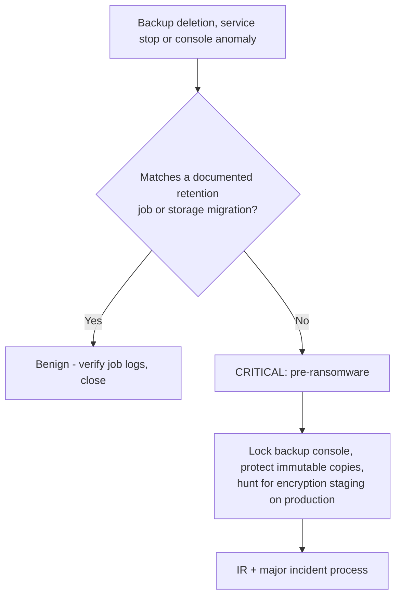

# Backup Infrastructure Attack

> Ransomware operators destroy or encrypt backups **before** they encrypt production, so the victim has to pay. They log in to the backup console (Veeam, Commvault, Rubrik, Cohesity), shorten retention, delete restore points, or dump the stored credentials (the backup server knows every domain and hypervisor password). **Activity on the backup server is a late-stage signal. Act immediately.**

## When this fires
- `win_backup_files_deleted` / `backup-files-deleted`: deletion of `.vbk`, `.vib`, `.bak`, `.vhdx` and similar backup files
- `win_backup_or_security_services_stopped` / `security-tool-service-stopped`: backup services (Veeam, SQL VSS writer) stopped together with security services
- `win_inhibit_system_recovery` / `shadow-copy-deletion`: shadow copies and the Windows backup catalogue deleted

## Triage decision tree


## Investigation steps
1. What touched backup files and services:
   ```kql
   DeviceFileEvents
   | where TimeGenerated > ago(2d) and ActionType == "FileDeleted"
   | where FileName endswith ".vbk" or FileName endswith ".vib" or FileName endswith ".vrb" or FileName endswith ".bak" or FileName endswith ".vhdx"
   | summarize Deleted = count(), Sample = make_set(FileName, 20) by DeviceName, InitiatingProcessAccountName, InitiatingProcessFileName, InitiatingProcessCommandLine
   ```
2. Backup console audit: logins (who, from where), retention / immutability changes, job deletions, restore-point deletions, and credential-store access. In Veeam this means the *Credentials* view, or exploitation of known Backup Service vulnerabilities on the CISA KEV list.
3. Credential exposure: the backup server stores domain, vCenter, ESXi and database credentials. Assume all of them are stolen if the server was accessed.
4. Look for parallel signs: [ESXi activity](esxi-hypervisor-ransomware.md), [ransomware precursors](ransomware-precursor.md), mass GPO changes.

## True vs false positive

| Points to attack | Points to benign |
|---|---|
| Restore points deleted from the console by a DA at 02:00 | Scheduled retention cleanup job (job log matches) |
| Immutability / retention reduced without a ticket | Storage migration project with approval |
| Backup services stopped together with AV / EDR | Backup software upgrade window |

## Containment & response
- Lock down the backup console (disable compromised accounts, enable MFA, block it from the general network) and **protect immutable and offline copies first**.
- Rotate every credential stored in the backup system.
- Verify restore capability from an untouched copy before production encryption starts.
- Harden: immutable or air-gapped copies (3-2-1-1-0), a backup server that is not domain-joined (or in a separate management domain), MFA and four-eyes approval for deletions, and timely patching of the backup software.

## Escalation criteria
Always escalate unexplained backup destruction as a major incident.

## Evidence to collect
Backup console audit logs, file deletion events, service events, credential-store access logs, timeline.
