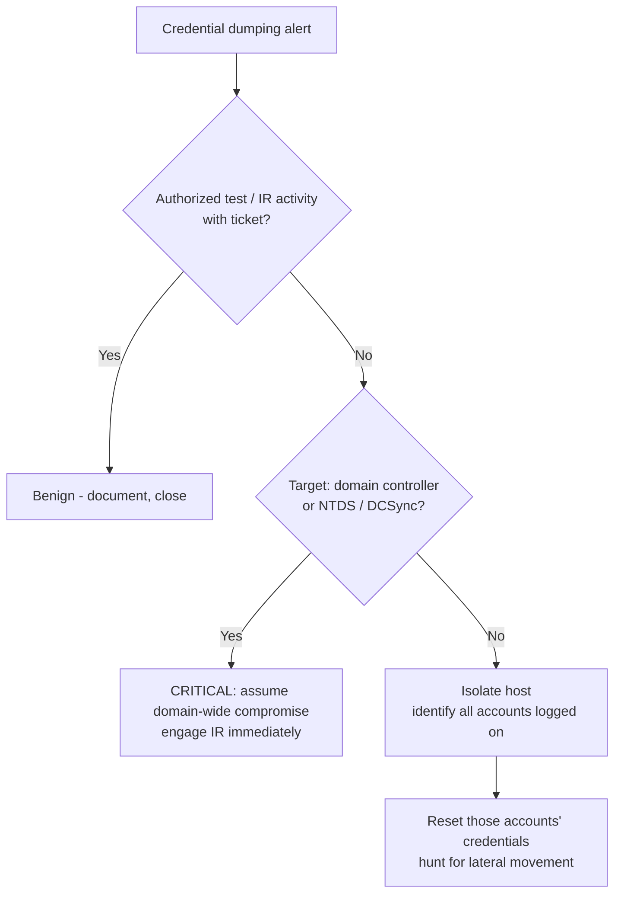

# Credential Dumping (LSASS, SAM, NTDS, DCSync)

> If this is real, the attacker is past initial access and harvesting credentials for lateral movement. Speed matters more than certainty.

## When this fires
- `win_lsass_credential_dump` (SecOps): Command lines associated with dumping LSASS process memory: comsvcs.dll MiniDump (LOLBin), Sysinternals ProcDump against lsass, and Mimikatz sekurlsa modules
- `win_sam_hive_dump` (SecOps): reg save/export of the SAM, SYSTEM or SECURITY hive - offline extraction of local password hashes and LSA secrets
- `win_ntds_dit_extraction` (SecOps): Attempts to copy the Active Directory database (ntds.dit) via ntdsutil IFM, shadow copies or raw copy tools
- `win_dcsync_tooling` (SecOps): DCSync and secrets-dumping tooling (Mimikatz lsadump::dcsync, Impacket secretsdump, Invoke-DCSync) that replicates password hashes from a domain controller
- `win_kerberoasting_tooling` (SecOps): Kerberoasting / AS-REP roasting tooling on the command line (Rubeus, Invoke-Kerberoast, GetUserSPNs, setspn -Q */*)
- `mde_credential_theft_alert` (SecOps): Defender alert for credential access (LSASS access, Mimikatz, credential dumping)
- `lsass-access-non-system` (Sentinel): A process that is not a known security or system component opens LSASS (OpenProcessApiCall)
- `lsass-dump-commandline` (Sentinel): Command lines that dump LSASS: comsvcs.dll MiniDump, ProcDump against lsass, or Mimikatz sekurlsa modules
- `kerberoasting-rc4-tgs` (Sentinel): One account requests RC4-encrypted (0x17) service tickets for 5+ different service accounts in an hour (4769)

## Triage decision tree


## Investigation steps
1. Confirm execution: did the process complete, and was a dump file written? (`.dmp` in Temp, `ntds.dit` copies, `SAM`/`SYSTEM` hive files)
2. Which accounts were exposed? Every account with an active session on the host - especially admins and service accounts:
   ```
   metadata.event_type = "USER_LOGIN" and target.hostname = "<HOST>" and security_result.action = "ALLOW"
   ```
3. How did the attacker get admin rights on this host? Work backwards: parent process, logon session, initial access.
4. Exfil of the dump: file transfer from the host shortly after (SMB, HTTP upload, rclone).
5. Lateral movement since: new logons from this host to others (RDP, SMB, WinRM, PsExec).

## True vs false positive

| Points to attack | Points to benign |
|---|---|
| `rundll32 comsvcs.dll MiniDump`, `procdump -ma lsass`, mimikatz strings | EDR or backup agent with documented LSASS access |
| SAM / SECURITY hive saved with `reg save` by a user process | Windows Error Reporting capturing a crash dump of LSASS |
| Preceded by privilege escalation or remote logon | Authorized red-team exercise with a deconfliction ID |

## Containment & response
1. Isolate the host (EDR network containment).
2. Reset passwords of every exposed account; for DC compromise also reset **KRBTGT twice** (10+ hours apart) per Microsoft guidance.
3. Disable compromised service accounts or rotate their secrets in PAM.
4. Hunt for the same tool hash/command line fleet-wide.

## Escalation criteria
Always escalate to IR. DCSync / NTDS extraction = major incident.

## Evidence to collect
Memory image of the host (if possible), command lines, dump file paths/hashes, logon sessions, lateral movement timeline.
