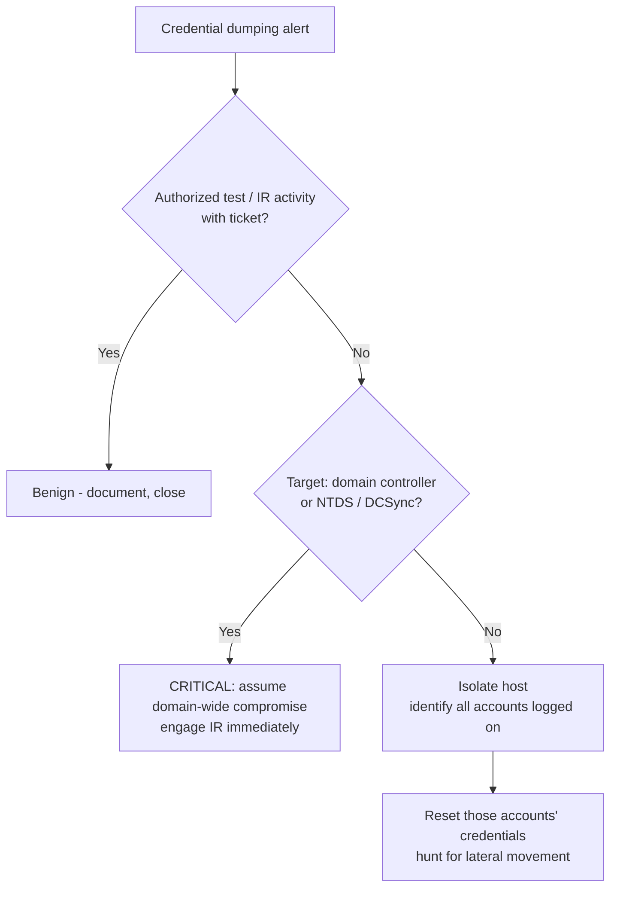

# Credential Dumping (LSASS, SAM, NTDS, DCSync)

> If this is real, the attacker is past initial access and harvesting credentials for lateral movement. Speed matters more than certainty.

## Triage decision tree


## Investigation steps
1. Confirm execution: did the process complete, and was a dump file written? (`.dmp` in Temp, `ntds.dit` copies, `SAM`/`SYSTEM` hive files)
2. Which accounts were exposed? Every account with an active session on the host - especially admins and service accounts:
   ```
   metadata.event_type = "USER_LOGIN" and target.hostname = "<HOST>" and security_result.action = "ALLOW"
   ```
3. How did the attacker get admin rights on this host? Work backwards: parent process, logon session, initial access.
4. Exfil of the dump: file transfer from the host shortly after (SMB, HTTP upload, rclone).
5. Lateral movement since: new logons from this host to others (RDP, SMB, WinRM, PsExec).

## Containment & response
1. Isolate the host (EDR network containment).
2. Reset passwords of every exposed account; for DC compromise also reset **KRBTGT twice** (10+ hours apart) per Microsoft guidance.
3. Disable compromised service accounts or rotate their secrets in PAM.
4. Hunt for the same tool hash/command line fleet-wide.

## Escalation criteria
Always escalate to IR. DCSync / NTDS extraction = major incident.

## Evidence to collect
Memory image of the host (if possible), command lines, dump file paths/hashes, logon sessions, lateral movement timeline.
