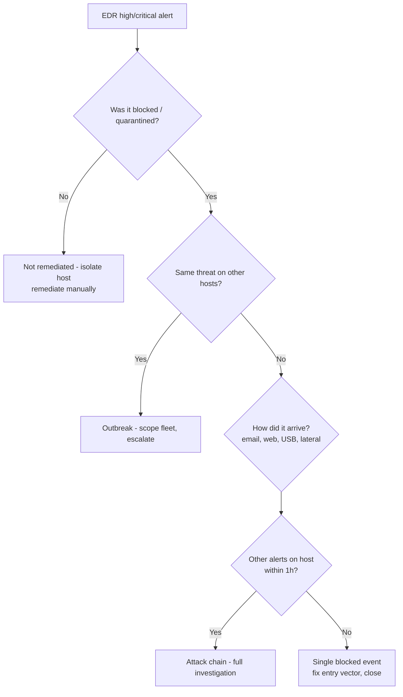

# EDR High-Severity Alert

> The EDR already did the hard work. Your job: confirm it was stopped, find out how it got there, and make sure it isn't anywhere else.

## Triage decision tree

## Investigation steps
1. Read the EDR's own process tree and storyline (Falcon process explorer, S1 Storyline, Defender incident graph).
2. Check remediation status: blocked, quarantined, killed - or detect-only?
3. Entry vector: parent process chain back to browser / Office / USB / remote session.
4. Prevalence: same hash / threat name on other hosts (`edr_same_threat_multiple_hosts`).
5. Other alerts on the host within ±1h (`edr_multiple_alerts_single_host`).

## Containment & response
- Use EDR network containment for unremediated threats or attack chains.
- Remove persistence the EDR may have missed (tasks, services, Run keys).
- If detect-only policy: move the host to a prevention policy.

## Escalation criteria
Not remediated, multiple hosts, credential theft, or hands-on-keyboard indicators → IR.

## Evidence to collect
EDR incident export, hashes, process tree, remediation status, entry vector.
