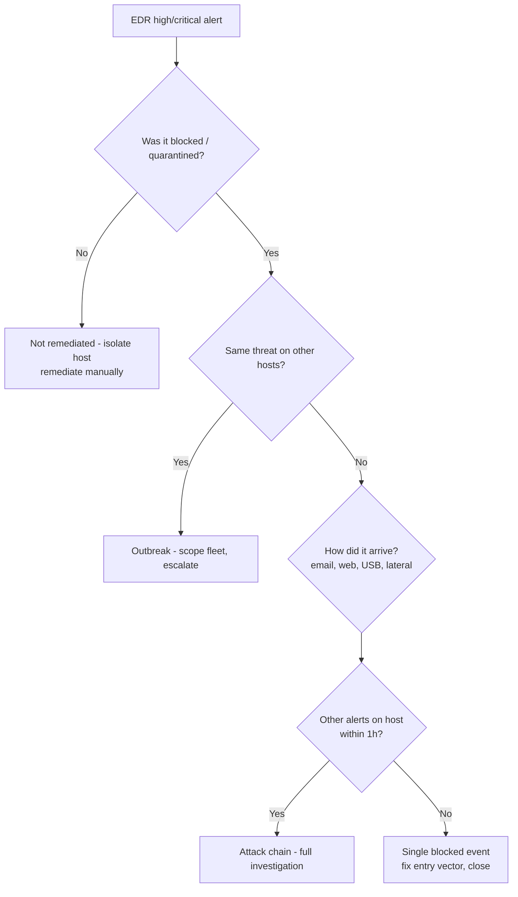

# EDR High-Severity Alert

> The EDR already did the hard work. Your job: confirm it was stopped, find out how it got there, and make sure it isn't anywhere else.

## When this fires
- `cs_detection_high_critical` (SecOps): CrowdStrike Falcon detection with High or Critical severity
- `s1_threat_high` (SecOps): SentinelOne threat with High or Critical severity
- `mde_alert_high` (SecOps): Microsoft Defender XDR alert with High severity
- `edr_malware_not_remediated` (SecOps): A malware detection where the EDR allowed the activity (no block/quarantine) - needs human remediation
- `edr_multiple_alerts_single_host` (SecOps): Three or more distinct EDR rules fired on the same host within one hour - likely a real attack chain rather than a single noisy rule
- `edr_same_threat_multiple_hosts` (SecOps): The same threat name detected on 3+ hosts within one hour - an outbreak or active lateral movement
- `defender-endpoint-high-alert-unresolved` (Sentinel): High severity Defender for Endpoint alerts that remain unresolved an hour after creation
- `defender-av-detection-not-remediated` (Sentinel): Defender Antivirus detected malware but the action was not successful (not quarantined/removed)
- `xdr-multi-stage-incident` (Sentinel): Within 24 hours, the same account or device appears in alerts from 3+ different Defender products (Endpoint, Office 365, Identity, Cloud Apps, Entra ID Protection)

## Triage decision tree

## Investigation steps
1. Read the EDR's own process tree and storyline (Falcon process explorer, S1 Storyline, Defender incident graph).
2. Check remediation status: blocked, quarantined, killed - or detect-only?
3. Entry vector: parent process chain back to browser / Office / USB / remote session.
4. Prevalence: same hash / threat name on other hosts (`edr_same_threat_multiple_hosts`).
5. Other alerts on the host within ±1h (`edr_multiple_alerts_single_host`).

## True vs false positive

| Points to attack | Points to benign |
|---|---|
| Threat not remediated, or active on more than one host | Remediated automatically with no follow-on activity |
| Alert part of a multi-stage incident (credential access, lateral movement) | Detection on a quarantined download that never executed |
| Hands-on-keyboard indicators in the process tree | Known penetration-testing tool on an approved test host |

## Containment & response
- Use EDR network containment for unremediated threats or attack chains.
- Remove persistence the EDR may have missed (tasks, services, Run keys).
- If detect-only policy: move the host to a prevention policy.

## Escalation criteria
Not remediated, multiple hosts, credential theft, or hands-on-keyboard indicators → IR.

## Evidence to collect
EDR incident export, hashes, process tree, remediation status, entry vector.
