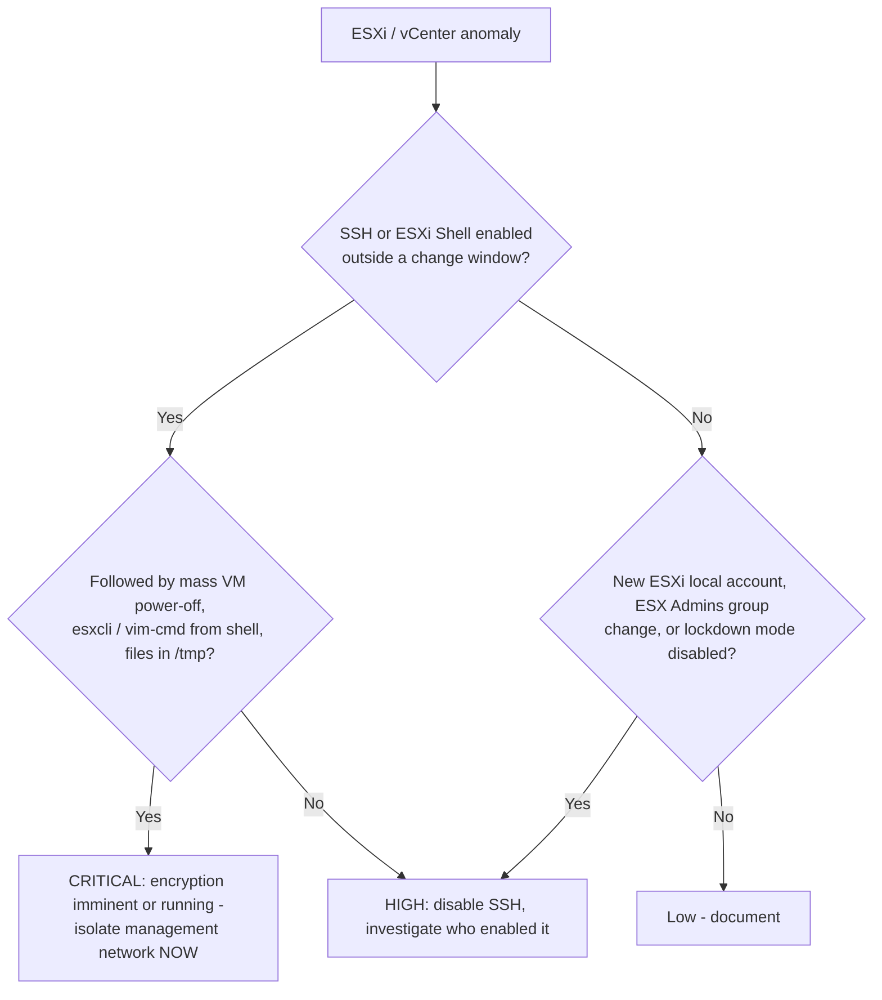

# ESXi / Hypervisor Ransomware

> Encrypting the hypervisor encrypts **every VM on it at once**, and ESXi has no EDR. Major ransomware families ship ESXi lockers. The common path is: vCenter or AD access → SSH enabled on hosts → VMs powered off → `.vmdk` files encrypted. If you only monitor Windows, **you will see this when the business calls**.

## When this fires
**Hunt-driven**, and it should become a scheduled analytic. It needs ESXi syslog (hostd, shell, auth) and vCenter events forwarded to the SIEM.

## Triage decision tree


## Investigation steps
1. SSH / shell enablement and shell commands on hosts:
   ```kql
   Syslog
   | where TimeGenerated > ago(3d)
   | where ProcessName in~ ("hostd", "shell", "sshd", "vobd", "Hostd") or SyslogMessage has_any ("SSH access has been enabled", "ESXi Shell", "esxcli", "vim-cmd", "vmsvc/power.off", "Lockdown mode")
   | project TimeGenerated, Computer, HostIP, ProcessName, SyslogMessage
   | order by TimeGenerated asc
   ```
2. Look for the ransomware sequence: `esxcli vm process list` / `kill`, `vim-cmd vmsvc/getallvms`, `power.off`, `esxcli system settings advanced set -o /User/execInstalledOnly -i 0`, binaries uploaded to `/tmp`, and `.vmdk` files renamed.
3. In vCenter: who logged in, from where, which hosts had SSH enabled via the API, and changes to SSO or the `ESX Admins` AD group (on domain-joined hosts, members of that group become ESXi administrators).
4. Back-track the access: the account used is usually a domain admin or vCenter admin obtained earlier. Check [DCSync](../identity/domain-replication-dcsync.md) and [PAM](../data/pam-vault-abuse.md).

## True vs false positive

| Points to attack | Points to benign |
|---|---|
| SSH enabled on many hosts within minutes, at night | Vendor support session with a ticket on one host |
| Mass VM power-off from shell, not from vCenter | Planned maintenance-mode evacuation via vCenter |
| New local ESXi root-equivalent account | Host profile remediation by the virtualization team |

## Containment & response
- **Cut the management network** (vCenter / ESXi management VLAN) from the rest of the network immediately; disable SSH and the ESXi Shell; enable lockdown mode.
- Do not reboot encrypted hosts before evidence capture. Snapshot what you can, and preserve logs.
- Recover from **immutable / offline backups**, and verify that backups were not deleted first ([backup attack](backup-infrastructure-attack.md)).
- Harden: no AD-joined ESXi (or remove the `ESX Admins` default), `execInstalledOnly`, lockdown mode, MFA on vCenter, a separate admin identity store, and patching of vCenter / ESXi CVEs on the CISA KEV list.

## Escalation criteria
Any unexplained SSH enablement combined with VM power-off or shell activity → major incident.

## Evidence to collect
ESXi and vCenter logs, `/var/log/shell.log`, `hostd.log`, `auth.log`, ransom note, sample of the encryptor, list of affected VMs.
