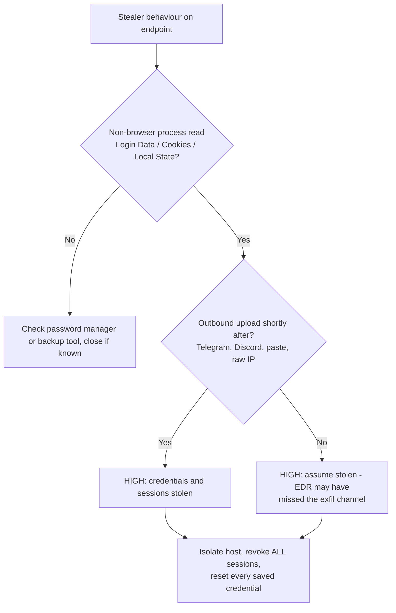

# Infostealer Infection (Browser Credential and Session Theft)

> Infostealers (Lumma, RedLine, Vidar, StealC and successors) grab saved passwords, **session cookies**, crypto wallets and VPN configs in seconds, then sell them as "logs". These logs feed most of today's account takeovers, ransomware initial access and SaaS data theft. **The machine is the smaller problem. The stolen sessions are the bigger one.**

## When this fires
- `win_browser_credential_theft`: a non-browser process reading browser credential stores (`Login Data`, `Cookies`, `Local State`), or known stealer command lines
- `threat-intel-file-hash-match` / `connection-to-file-sharing-paste-sites`: known stealer hash, or exfiltration to paste, file-sharing, Telegram or Discord endpoints

## Triage decision tree


## Investigation steps
1. Which process touched the browser secrets:
   ```kql
   let host = "<DEVICE_NAME>";
   DeviceEvents
   | where TimeGenerated > ago(3d) and DeviceName startswith host
   | where ActionType == "SensitiveFileRead" or AdditionalFields has_any ("Login Data", "Cookies", "Local State", "logins.json", "key4.db")
   | project TimeGenerated, ActionType, FileName, FolderPath, InitiatingProcessFileName, InitiatingProcessFolderPath, InitiatingProcessCommandLine, InitiatingProcessSHA256
   ```
2. Find how it arrived: cracked software, a fake installer from a malvertised search result, "ClickFix" (the user pasted a command into Win+R or PowerShell), or a game-cheat download. Check browser downloads and `RunMRU`.
3. Inventory what was exposed: the browsers' saved sites, signed-in SaaS (Microsoft 365, Google, Okta, AWS console, GitHub), VPN profiles, password-manager extensions and crypto wallets.
4. Hunt for **use of the stolen sessions** in the following days: sign-ins from new ASNs with the user's existing session ([token theft](../identity/token-theft-session-replay.md)).

## True vs false positive

| Points to stealer | Points to benign |
|---|---|
| Unsigned exe in `%TEMP%` / `%APPDATA%` reads every browser's `Login Data` | Password manager importing from the browser (user-initiated) |
| POST to `api.telegram.org` or a raw IP right after | Browser profile migration / backup tool |
| Execution began from a "cracked" installer or a pasted PowerShell command | Enterprise browser management agent |

## Containment & response
- Isolate the host and reimage it. Stealers are often a loader for more malware.
- **Revoke sessions everywhere** the user was signed in (Entra, Google, Okta, GitHub, AWS, SaaS apps), then reset every saved password. Prioritize admin consoles and VPN.
- Check personal devices if corporate SaaS was used on them. Stealer logs often come from home PCs.
- Block execution from user-writable folders (ASR / WDAC), and turn off browser password saving in favour of an enterprise password manager.

## Escalation criteria
Privileged or admin-console sessions exposed, signs of session reuse, or multiple infected users → IR.

## Evidence to collect
Process tree and binary, file-read events, network connections, the list of exposed credentials and sessions, and remediation evidence (revocations, resets).
