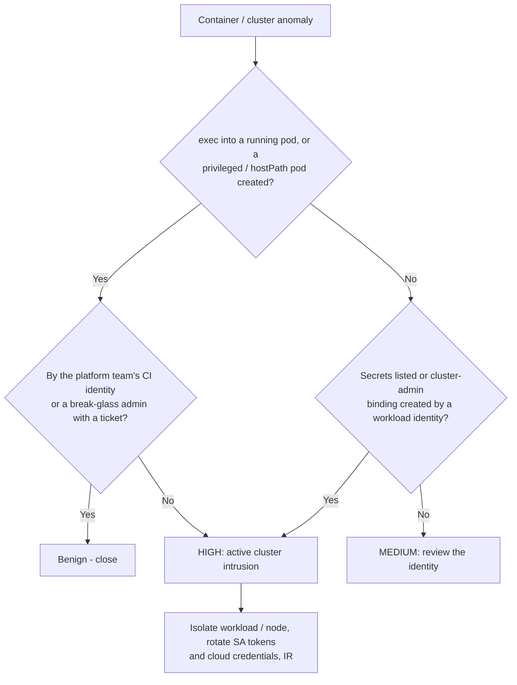

# Kubernetes / Container Compromise

> A vulnerable or exposed workload gives a shell in a container. From there, the attacker reads the **service-account token**, talks to the Kubernetes API, launches a **privileged pod** to escape to the node, and steals cloud credentials from the node's identity. Container logs are short-lived, so **API audit logs are your memory**.

## When this fires
- `lnx_privileged_container`: a container started privileged, with host PID / network, or with the host filesystem mounted
- `azure_aks_admin_credentials` / `azure-aks-admin-credentials`: cluster admin credentials (`listClusterAdminCredential`) retrieved
- `azure_acr_credentials` / `azure-acr-credentials`: container registry admin credentials read
- Hunt below: `exec` into pods, secret reads, cluster-admin role bindings in the API audit log

## Triage decision tree


## Investigation steps
1. AKS API audit (Diagnostic setting: `kube-audit` / `kube-audit-admin`):
   ```kql
   AzureDiagnostics
   | where TimeGenerated > ago(2d) and Category in ("kube-audit", "kube-audit-admin")
   | extend Log = parse_json(tostring(column_ifexists("log_s", "")))
   | extend Verb = tostring(Log.verb), Resource = tostring(Log.objectRef.resource), Sub = tostring(Log.objectRef.subresource),
            Namespace = tostring(Log.objectRef.namespace), User = tostring(Log.user.username), SourceIP = tostring(Log.sourceIPs[0])
   | where Sub == "exec" or (Resource == "secrets" and Verb in ("get", "list")) or Resource in ("clusterrolebindings", "rolebindings") or (Resource == "pods" and Verb == "create")
   | project TimeGenerated, User, SourceIP, Verb, Resource, Sub, Namespace, RequestObject = tostring(Log.requestObject)
   ```
   In `RequestObject`, look for `"privileged":true`, `hostPID`, `hostNetwork` and `hostPath` mounts.
2. Inside the workload: shells, package installs, `curl` / `wget` of tools, miners, and reads of `/var/run/secrets/kubernetes.io/serviceaccount/token`.
3. Cloud pivot: node or workload identity used from outside the cluster (IMDS theft, see [instance credential theft](../cloud/instance-credential-theft.md)).
4. Image provenance: was the image pulled from your registry, signed, and recently changed?

## True vs false positive

| Points to attack | Points to benign |
|---|---|
| `kubectl exec` by a pod's own service account | SRE exec during an incident, with a ticket |
| Privileged pod with `hostPath: /` in a default namespace | DaemonSet from the security vendor (documented) |
| Secrets listed cluster-wide by a workload identity | Operator / controller with scoped RBAC |

## Containment & response
- Cordon and drain the affected node or isolate the namespace with network policy; delete malicious pods (preserve them first).
- Rotate service-account tokens, secrets reachable from the namespace, and the node / workload cloud identity.
- Harden: Pod Security Admission (restricted), no `automountServiceAccountToken` where not needed, least-privilege RBAC, private API server, image signing and admission control, and Defender for Containers / runtime security.

## Escalation criteria
Container escape to the node, cluster-admin compromise, or cloud credential theft → IR.

## Evidence to collect
API audit logs, pod specifications, container image and filesystem snapshot, node forensics, RBAC state before and after.
