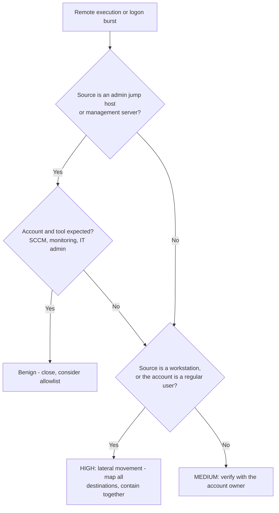

# Lateral Movement via PsExec / WMI / Remote Services

> One account authenticating to many hosts over the network, or running commands remotely through PsExec, WMI, WinRM or service creation, is how an intrusion spreads from one laptop to the domain. **Map the blast radius before you contain**, otherwise you clean one host while the attacker keeps others.

## When this fires
- `win_psexec_remote_execution`: PsExec / PAExec / impacket `psexec` and `smbexec` patterns (`PSEXESVC`, random service names, `\\host\ADMIN$`)
- `win_wmic_remote_process_create` / `wmi-spawns-shell`: `wmic /node:` or `Invoke-WmiMethod Win32_Process Create`, and `WmiPrvSE.exe` spawning shells
- `win_lateral_network_logon_burst` / `lateral-movement-network-logon-burst`: one account with type 3 logons to many hosts in a short window

## Triage decision tree


## Investigation steps
1. Map every destination of the source account or host:
   ```kql
   let acct = "<ACCOUNT>";
   SecurityEvent
   | where TimeGenerated > ago(1d) and EventID == 4624 and LogonType in (3, 10) and TargetUserName =~ acct
   | summarize Hosts = dcount(Computer), HostList = make_set(Computer, 100), First = min(TimeGenerated), Last = max(TimeGenerated)
       by IpAddress, AuthenticationPackageName
   | order by Hosts desc
   ```
2. On each destination, look for what ran: new services (7045), `WmiPrvSE.exe` children, `wsmprovhost.exe` children, and files written to `ADMIN$` / `C$`.
   ```kql
   DeviceProcessEvents
   | where TimeGenerated > ago(1d)
   | where InitiatingProcessFileName in~ ("wmiprvse.exe", "wsmprovhost.exe", "psexesvc.exe", "services.exe")
   | where FileName in~ ("cmd.exe", "powershell.exe", "pwsh.exe", "rundll32.exe", "mshta.exe")
   | project TimeGenerated, DeviceName, AccountName, InitiatingProcessFileName, FileName, ProcessCommandLine
   ```
3. NTLM network logons from a workstation to many servers can mean **pass-the-hash**. Check `AuthenticationPackageName` and the `LogonProcessName`.
4. Identify how the source host was compromised, which is the patient-zero question.
5. SecOps pivot:
   ```
   metadata.event_type = "USER_LOGIN" AND principal.ip = "<SOURCE_IP>" AND extensions.auth.mechanism = "NETWORK"
   ```

## True vs false positive

| Points to attack | Points to benign |
|---|---|
| Regular user account logging on to 20 servers | Patch or inventory service account from the management server |
| Random 8-character service names created remotely | PsExec run by a named admin from the PAW during a change |
| NTLM from a workstation, off-hours | Monitoring tool with a stable pattern for months |

## Containment & response
- Contain the **source and all confirmed destinations together**; disable or reset the account (and its other credentials).
- Block SMB / WinRM / RPC from workstations to workstations and servers (host firewall), allowing only admin jump hosts.
- Enable LAPS / Windows LAPS so local admin passwords are unique; restrict local admin rights.
- Hunt for persistence on every destination ([persistence](persistence-task-service-runkey.md)).

## Escalation criteria
Confirmed lateral movement by a non-admin path, privileged credentials in use, or tier-0 destinations (DCs, PAM, backup) → IR.

## Evidence to collect
Logon events per destination, remote-execution artefacts (services, WMI, files), source host timeline, and the list of credentials exposed on each host.
