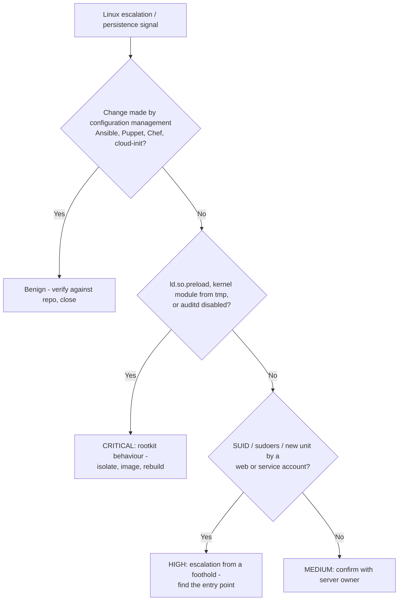

# Linux Privilege Escalation and Stealth Persistence

> On Linux servers, attackers go from web user or service account to root by abusing **sudo rules, SUID binaries or kernel bugs**. They then hide with **LD_PRELOAD, kernel modules or systemd units**, and turn off auditd. Rootkit-style persistence makes the host's own tools lie to you, so **trust auditd and EDR telemetry over commands run on the box**.

## When this fires
- `lnx_sudoers_or_group_escalation` / `sudo-failures-and-root-shell`: edits to `/etc/sudoers`, users added to `sudo` / `wheel`, or sudo failures followed by a root shell
- `lnx_setuid_bit_set`: `chmod u+s` / `chmod 4755` on binaries
- `lnx_ld_preload_hijack`: writes to `/etc/ld.so.preload` or `LD_PRELOAD` in service environments
- `lnx_kernel_module_from_tmp`: `insmod` / `modprobe` of modules from `/tmp`, `/dev/shm` or home directories
- `lnx_systemd_service_persistence`, `lnx_auditd_tampering`: new units or timers, and auditd stopped or its rules deleted

## Triage decision tree


## Investigation steps
1. Root-relevant changes from Syslog / auditd:
   ```kql
   Syslog
   | where TimeGenerated > ago(3d)
   | where SyslogMessage has_any ("ld.so.preload", "insmod", "modprobe", "chmod 4", "u+s", "sudoers", "usermod -aG", "systemctl enable", "auditctl -D", "service auditd stop")
   | project TimeGenerated, Computer, Facility, ProcessName, SyslogMessage
   | order by TimeGenerated asc
   ```
2. Compare the host against the package database: `rpm -Va` / `debsums`, unsigned kernel modules (`lsmod` versus `/lib/modules`), and SUID binaries not owned by a package. Run these from trusted media if a rootkit is suspected.
3. Find the foothold: web server or application user spawning shells ([web shell](webshell.md)), SSH key additions ([Linux reverse shell](linux-reverse-shell.md)), exposed services.
4. Check for credential harvesting: `/etc/shadow` reads, SSH private keys, cloud credentials in home directories.

## True vs false positive

| Points to attack | Points to benign |
|---|---|
| `/etc/ld.so.preload` created on a web server | APM agent documented to use preload (rare; verify the vendor) |
| Kernel module loaded from `/dev/shm` | DKMS-built driver from the package manager |
| `www-data` adds a sudoers line | Ansible run with a matching commit |

## Containment & response
- Isolate the host. For rootkit indicators, **image it and rebuild** rather than clean in place.
- Rotate credentials and keys present on the host; remove any SSH keys the attacker added on other hosts.
- Harden: minimal sudo rules (no NOPASSWD to shells or editors), `nosuid` mounts for `/tmp` and `/dev/shm`, Secure Boot and module signing, auditd rules shipped off-host in real time, and an EDR for Linux.

## Escalation criteria
Rootkit indicators, root compromise of a production server, or credential theft → IR.

## Evidence to collect
auditd and syslog (from the SIEM copy), disk image, list of modified files, package verification output.
