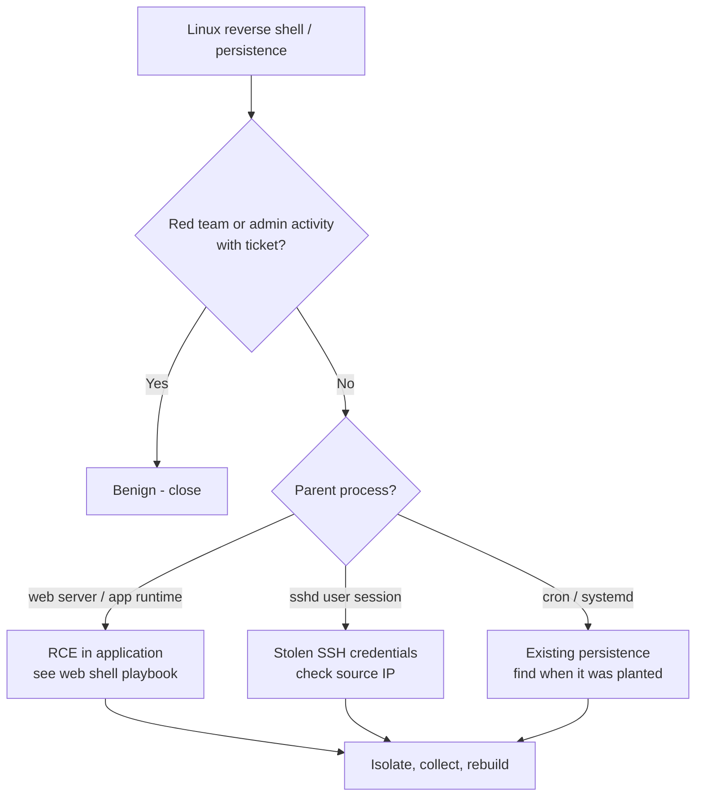

# Linux Reverse Shell and Persistence

> Interactive attacker access on a Linux server, usually followed by SSH-key or cron persistence and often a cryptominer.

## Triage decision tree

## Investigation steps
1. Destination IP/port of the reverse shell; enrich and hunt across the fleet.
2. Persistence sweep on the host: `crontab -l` for all users, `/etc/cron*`, systemd units, `~/.ssh/authorized_keys`, `/etc/ld.so.preload`, new users in `/etc/passwd`.
3. Entry vector: web server logs, SSH auth logs (`lnx_ssh_bruteforce`), vulnerable services.
4. Impact: cryptominer CPU use, credential files read (`/etc/shadow`, cloud credentials in `~/.aws`).

## Containment & response
- Isolate the host (security group / firewall / EDR).
- Prefer **rebuild from a known-good image** over cleanup.
- Rotate SSH keys, cloud credentials and secrets present on the host.

## Escalation criteria
Always IR for confirmed reverse shells. Cloud credentials on the host → also run the cloud credential playbook.

## Evidence to collect
Command lines, attacker IPs, persistence artifacts, bash history (if not wiped), memory / disk snapshot.
